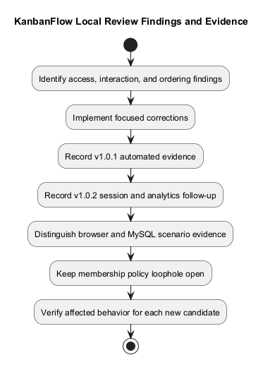
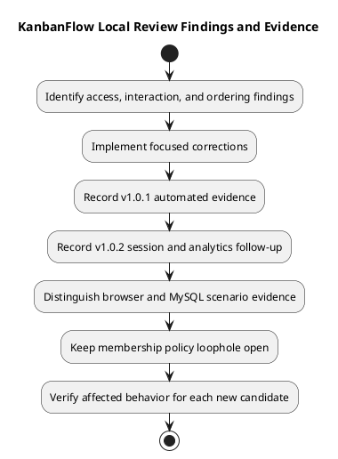

# KanbanFlow Local Review Fixes

> **Policy amendment (2026-10-10):** Membership mutations are now owner-only; DEC-003/PB-001's bypass is fixed. Earlier open-policy text and diagrams below describe the preceding state. See [QA corrections](SDLC/06-testing/qa-corrections-2026-10-10.md) for the selected rule and regression evidence.

This record explains the ten corrections identified in the original local source review, their release context, and the limits of the recorded verification. The initial fixes shipped in [v1.0.1](Releases/v1.0.1.md); [v1.0.2](Releases/v1.0.2.md) subsequently addressed session configuration, analytics refresh, and specific verification gaps. This document update does not change application behavior or constitute a fresh application test run.

## Review scope and evidence

The review covered workspace membership, private-board access, authentication feedback, role-aware controls, Kanban interaction, and ordering consistency. It was a focused source review, not a comprehensive security audit or proof that all defects were eliminated.

| Evidence | Reference and meaning |
| --- | --- |
| Initial correction release | [v1.0.1 record](Releases/v1.0.1.md), tagged commit `cceb9f6550a35275e23fa518f575ecd017c70e0e` |
| Follow-up release | [v1.0.2 record](Releases/v1.0.2.md), tagged commit `6891034c5310040051bbe641fe39375ada6228f8` |
| Later interface improvements | [v1.1.0 record](Releases/v1.1.0.md) |
| Historical change descriptions | [Changelog](../CHANGELOG.md) |
| Remaining policy and work | [Decision register](Project-Management/decision-register.md) and [product backlog](Project-Management/product-backlog.md) |

Use the tagged release when investigating historical behavior. Current `main` includes later changes and documentation updates. Dates, outcomes, and test totals below refer to their recorded releases; they are not automatically refreshed by editing this file.

## Original correction register

| ID | Area | Recorded correction | Verification focus |
| --- | --- | --- | --- |
| LR-01 | Private-board access | Private boards are accessible to their creator and current workspace owners/managers, subject to workspace membership. Other members can access workspace-visible boards. | Compare authorized roles with ordinary members and removed users. |
| LR-02 | Nested visibility | Board listings, nested task/comment endpoints, analytics, and task activity feeds enforce the board visibility boundary. | Check both direct endpoints and aggregate/list responses for private data exposure. |
| LR-03 | Removed comment authors | Workspace removal revokes comment editing/deletion access, including for comments authored before removal. | Attempt mutations after membership is removed. |
| LR-04 | Authentication | Login requests are limited to five per minute per account/IP pair and thirty per minute per IP; authentication errors return JSON to the frontend. | Verify throttling and structured error feedback in an isolated environment. |
| LR-05 | Role-aware controls | Workspace, project, board, column, task, and member controls respect the signed-in user's role; direct role changes are reserved for owners. | Compare UI affordances and server authorization; retain the indirect-change issue below. |
| LR-06 | Member-operation feedback | Validation, permission, expired-session, and connection failures are displayed. | Reject operations and verify understandable feedback without a false success state. |
| LR-07 | Optimistic task movement | Cached source/destination lists update immediately; rejected moves restore prior lists and refresh server state. | Reject a move, inspect both lists, and reload to confirm persisted state. |
| LR-08 | Keyboard movement | Boards, columns, and tasks support keyboard dragging with focusable move/drag handles. | Check pickup, movement, drop, cancellation, and persistence. |
| LR-09 | Deletion ordering | Board and column deletion renumbers remaining positions. | Delete an interior item and verify remaining ordered positions. |
| LR-10 | Position and stale-task consistency | Ordered allocation/movement uses parent row locks; task changes lock and recheck the task and its source column, rejecting conflicting stale operations. | Separate sequential regression checks from database contention experiments. |

These IDs organize this document; they are not invented issue tracker numbers or claims of additional fixes. The register describes the recorded corrections and the relevant checks, not a claim that every scenario was executed in every environment.

## Access-control interpretation

Visibility rules apply to server responses as well as screen controls. Hiding a button does not prevent a direct request. A removed member must lose the applicable workspace access even when they previously created a comment or board.

Private-board access for current owners/managers is part of the recorded rule. Do not describe these boards as creator-only. The correction can remove access that an ordinary member previously had to another user's private board; this is an intentional historical access change.

**Remaining issue:** a manager can remove and re-add a member with a different role, bypassing the intended owner-only direct role-change restriction. The direct-update correction in LR-05 does not close this indirect path. [DEC-003](Project-Management/decision-register.md) and [PB-001](Project-Management/product-backlog.md) track the unresolved policy and enforcement work. Workspace owners should manage membership until it is resolved.

## Interaction and ordering interpretation

For the recorded keyboard flow, focus the move/drag handle, press Space to pick up, use arrow keys to move, and press Space to drop or Escape to cancel. Verify the current interface when assessing a new candidate; the instructions alone are not evidence of successful browser behavior.

Optimistic movement improves immediate feedback but must agree with the server after rejection or reload. Check source and destination lists together; a visually restored card alone does not demonstrate correct persisted ordering.

Parent-row locking and task revalidation address specific allocation and stale-state boundaries. SQLite tests do not demonstrate MySQL lock behavior, and successful contention experiments do not establish every possible interleaving or production capacity.

## Historical verification

| Release | Recorded verification | Limits |
| --- | --- | --- |
| v1.0.1 | Backend: 160 tests, 459 assertions; frontend lint, TypeScript checks, and production build passed. | Backend suite used in-memory SQLite; browser keyboard/rollback and MySQL contention checks remained outstanding then. |
| v1.0.2 | Backend: 163 tests, 470 assertions; frontend checks passed. Isolated browser checks covered login, live project totals, persisted keyboard task reorder, and WIP rejection/rollback. | Specific observed scenarios, not a full browser matrix or all workflows. |
| v1.0.2 | Disposable MySQL checks used four competing task requests against a one-task WIP limit and four competing column requests allocating distinct positions. | Separate from SQLite tests; no complete concurrency or load guarantee. |

Seven backend regression tests were added with the initial review fixes, covering private-board visibility and authorized access, viewer exclusion, private task activities, removed comment authors, deletion ordering, and login rate limiting. The totals above refer to the complete suites, not just these regressions.

The [v1.0.1 CI run](https://github.com/Farhad-Valizadegan/Web-KanbanFlow/actions/runs/37528446171) is linked in its release record. Later release notes retain the context of additional checks. No extra raw logs, numerical coverage, reviewer identities, or production verification are inferred here.

## Follow-up issues and status boundaries

| Item | Initial release position | Later recorded position |
| --- | --- | --- |
| Mixed localhost/127.0.0.1 examples and missing frontend stateful origin | Open in v1.0.1. | Addressed by v1.0.2 configuration defaults and session regressions. |
| Stale workspace analytics after project changes | Open in v1.0.1. | Addressed by v1.0.2 cache invalidation and observed project-count refresh. |
| Keyboard reorder and rollback browser evidence | Outstanding in v1.0.1. | Specific isolated scenarios recorded in v1.0.2. |
| MySQL contention evidence | Outstanding in v1.0.1. | Specific disposable-data experiments recorded in v1.0.2. |
| Manager remove/re-add role loophole | Open in v1.0.1. | Remains open in current planning. |
| Local Web-KanbanFlow folder rename | Pending in historical v1.0.2 notes. | Completed later; historical release notes retain their original context. |

The later UI/theme release has its own [v1.1.0 evidence](Releases/v1.1.0.md). Do not combine historical totals into a new verification result or interpret a published source release as a production deployment.

## Reverify a new candidate

1. Record the exact source commit, environment, database, browser, and acceptance criteria using the [verification template](Releases/verification-template.md).
2. Run relevant automated checks and record their actual results, including unavailable or blocked checks.
3. Exercise affected access paths with appropriate isolated users and roles; include direct requests and aggregate responses.
4. Check keyboard persistence and rejected-move recovery when interaction or ordering behavior changes.
5. Use disposable data for authorized MySQL contention checks when locking behavior is affected.
6. Keep remaining membership-policy risk visible in the review outcome and [release checklist](Releases/release-checklist.md).

Record pass, fail, blocked, not run, and justified not-applicable states separately. Describe evidence gaps without replacing them with assumed success. Use the [quality and risk plan](Project-Management/quality-and-risk-plan.md) to choose checks proportionate to the change.

## Maintenance

Preserve this historical correction register. Add later resolution context with its source and evidence rather than rewriting publication-time gaps as if they had already been closed. Follow the [diagram guide](diagram-guide.md) when updating the source and preview below. Return to the [documentation index](README.md) for related material.

## Review and evidence diagram

[PlantUML source](diagrams/LOCAL_REVIEW_FIXES.puml)

