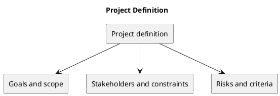

# Project Definition

KanbanFlow organizes collaborative work into workspaces, projects, boards, columns, and tasks. This section defines the working product scope. Goals and acceptance criteria here are proposed definitions, not recorded stakeholder approvals.

## Documents

- [Overview and Goals](overview-and-goals.md)
- [Project Problem Statement](project-problem-statement.md)
- [Scope and Stakeholders](scope-and-stakeholders.md)
- [Stakeholders and External Systems](stakeholders-and-external-systems.md)
- [Assumptions and Constraints](assumptions-and-constraints.md)
- [Risks and Success Criteria](risks-and-success-criteria.md)
- [Project Context Diagram](project-context-diagram.md)
- [Scope Boundary Diagram](scope-boundary-diagram.md)

## Sources and maintenance

Consult the [project README](../../README.md), [API routes](../../backend/routes/api.php), and implementation for delivered behavior. Each document contains PlantUML source, with an identical standalone file under diagrams/. Keep both copies synchronized. GitHub may show PlantUML blocks as source; use a compatible renderer for visual output.

## PlantUML diagram

[Standalone source](diagrams/README.puml)

