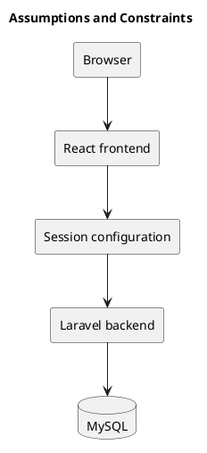

# Assumptions and Constraints

Users need a modern browser and access to the running services. Operators must configure frontend/backend URLs, session cookies, and database connectivity correctly.

The current stack uses React, TypeScript, Vite, Laravel, and MySQL. Exact runtime requirements are defined by package manifests. Theme preferences are stored in the browser rather than a shared account setting.

No numerical availability or capacity commitment is defined here. Offline editing and real-time synchronization are outside this working scope. Intended role restrictions require closure of the known membership loophole.

## Configuration dependencies

- Backend dependency requirements: [Composer manifest](../../backend/composer.json).
- Frontend commands and dependencies: [npm manifest](../../frontend/package.json).
- Runtime environment setup: [project setup guide](../../README.md).

Treat database backups, availability targets, and production capacity as operational decisions to document before deployment.

## PlantUML diagram

[Standalone source](diagrams/assumptions-and-constraints.puml)

