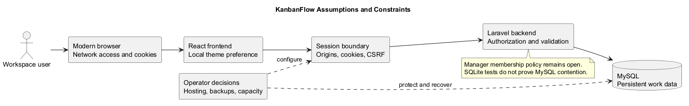
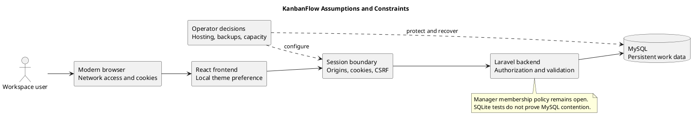

# Assumptions and Constraints

This document defines the conditions KanbanFlow depends on and the boundaries that affect its design, verification, and operation. Assumptions require confirmation in the target environment; constraints describe current implementation or explicit scope boundaries. Proposed operational targets are not service guarantees.

## User and collaboration assumptions

| ID | Assumption | Validation or consequence |
| --- | --- | --- |
| A-01 | Users have a modern browser, network access, and cookies enabled. | Verify sign-in and core journeys in the supported target browsers; no browser compatibility matrix has been established. |
| A-02 | Users organize work through workspaces, projects, boards, columns, and tasks. | Validate the workspace-to-task journey with representative users. |
| A-03 | Workspace owners make membership decisions. | Confirm the intended manager policy before claiming owner-only role changes are fully enforced. |
| A-04 | Operators provide reachable application services and a configured database. | Verify runtime connectivity and environment configuration before use. |
| A-05 | Users need visible task state and ownership. | Treat productivity benefits as hypotheses until supported by user observations. |

## Technical constraints

| Area | Current constraint and evidence |
| --- | --- |
| Backend | Laravel with Sanctum session authentication. The [Composer manifest](../../backend/composer.json) declares PHP ^8.3 and Laravel ^13.8; exact installed requirements also depend on the lockfile. |
| Frontend | React, TypeScript, Vite, and Tailwind; [package.json](../../frontend/package.json) defines dependency ranges and lint/build commands. |
| Verified CI runtime | [CI](../../.github/workflows/ci.yml) uses PHP 8.4 and Node.js 24. These are the configured CI versions, not an independently established universal minimum. |
| Persistence | Application data uses the configured database; MySQL is the documented local application setup. |
| Authorization | Backend access checks must enforce resource permissions. Hidden buttons alone do not protect resources. |
| Preferences | Theme preference is stored in the browser, rather than synchronized as an account setting across devices. |
| Test database | [PHPUnit configuration](../../backend/phpunit.xml) uses in-memory SQLite. MySQL contention requires separate verification. |

Use lockfiles for reproducible dependency installation. A successful build does not prove browser usability, production capacity, or database concurrency correctness.

## Authentication and configuration dependencies

The frontend URL, backend URL, stateful origins, cookie settings, and CSRF flow must agree. Mixing hostnames can break session behavior even when both services respond.

For the documented local setup:

| Setting | Local example |
| --- | --- |
| APP_URL | http://localhost:8000 |
| VITE_API_URL | http://localhost:8000 |
| FRONTEND_URL | http://localhost:5173 |
| SANCTUM_STATEFUL_DOMAINS | localhost:5173,localhost:8000 |

These examples are for local development. Production values must match the deployed domains and transport. Review [Sanctum configuration](../../backend/config/sanctum.php), [session configuration](../../backend/config/session.php), and the [setup guide](../../README.md). Clear stale configuration and restart services after relevant environment changes. Keep secrets and real environment files out of documentation and commits.

## Data and workflow constraints

- Saved changes depend on successful backend requests and database availability.
- Task movements must preserve valid ordering and respect applicable WIP limits.
- Failed optimistic UI updates must recover to the server's accepted state.
- Concurrent users can affect ordering and task state; changes at these boundaries require relevant regression and contention checks.
- A code rollback does not automatically reverse database changes or restore deleted data.

These are behavioral requirements and verification boundaries. They do not imply that every scenario has been freshly tested for every commit.

## Product scope boundaries

Offline editing, a guaranteed real-time synchronization service, billing, payroll, and third-party task synchronization are outside the current working definition. Current notification documentation describes database notifications, without promising email or SMS delivery.

See the [scope boundary](scope-boundary-diagram.md) before proposing additions. New integrations require explicit requirements for data, permissions, errors, and operational dependencies.

## Operational constraints and open decisions

| Topic | Current position | Decision or evidence needed |
| --- | --- | --- |
| Availability and capacity | No numerical uptime, throughput, or response-time commitment is established. | Agree targets and measure them in the intended environment. |
| Backup and recovery | A source release is not a data backup. | Define backup ownership, retention, restore steps, and a verified restore exercise. |
| Deployment | CI runs checks; it does not establish a production deployment. | Confirm hosting, environment, deployment authorization, and smoke checks. |
| Browser support | Modern browser use is assumed; no full compatibility matrix is recorded here. | Select and verify supported browsers and assistive interaction. |
| Membership permissions | Manager remove/re-add can bypass intended owner-only role-change restrictions. | Decide the permitted manager operations, implement enforcement, and verify regression coverage. |

Owners should manage membership while the known loophole remains unresolved. Track its decision in the [decision register](../Project-Management/decision-register.md).

## Validation and maintenance

For each affected change, identify the exact commit and environment, run relevant tests, and document unverified boundaries. Browser journeys should cover authentication, saved state, themes, keyboard use, and narrow layouts when affected. Database contention checks should use an isolated database.

Review this document when dependency/runtime requirements, deployment topology, authentication configuration, browser support, permissions, or scope changes. Historical checks remain historical; use a [verification record](../Releases/verification-template.md) for fresh release evidence.

## PlantUML diagram

[Editable source](diagrams/assumptions-and-constraints.puml)

