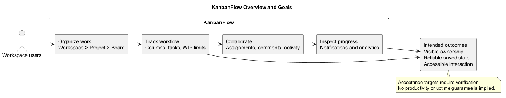
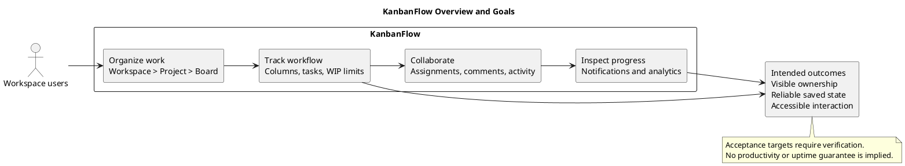

# KanbanFlow Overview and Goals

## Product overview

KanbanFlow is a full-stack, browser-based project management application. It organizes collaborative work into workspaces, projects, boards, workflow columns, and tasks so users can inspect ownership and progress in a shared place.

The React and TypeScript frontend provides the interface. The Laravel backend handles authentication, authorization, validation, and persistence through the configured database. MySQL is the documented application setup. See the [system context](project-context-diagram.md) and [project README](../../README.md) for implementation and setup details.

## Purpose and problem

The working problem hypothesis is that scattered task information makes ownership, priorities, and workflow progress hard to follow. KanbanFlow responds with structured boards, assigned tasks, and task-related collaboration.

This purpose is a product definition, not proof of increased productivity. Validate the hypothesis with representative users and observed journeys; see the [problem statement](project-problem-statement.md).

## Intended users

| User | Intended use |
| --- | --- |
| Workspace owner | Organize the workspace and make membership decisions. |
| Manager | Coordinate work within the permissions enforced by the backend. |
| Member | Contribute to tasks and collaborate within permitted workspaces. |
| Viewer | Inspect information within permitted workspaces. |
| Maintainer or operator | Develop, verify, configure, and run the application. |

These descriptions are not a complete authorization matrix. The manager remove/re-add role-change loophole remains unresolved; owners should manage membership until the policy and enforcement are corrected.

## Work model

| Level | Purpose |
| --- | --- |
| Workspace | Collaboration boundary with membership and roles. |
| Project | Group related work and its boards. |
| Board | Present a workflow for a project. |
| Column | Represent a workflow stage and optional WIP limit. |
| Task | Record actionable work, priority, ownership, and related discussion. |

A typical journey is to sign in, open or create a permitted workspace, select a project and board, create workflow columns, then add, assign, and move tasks. Access and management actions depend on authorization.

## Current capabilities

- Registration, login, logout, authenticated sessions, and protected routes.
- Workspace membership and project/board management.
- Ordered columns and tasks, drag-and-drop interaction, keyboard movement, and WIP limits.
- Task priorities, descriptions, due dates, assignments, and completion state.
- Comments, activity history, database notifications, and workspace analytics.
- List search, responsive navigation, Light/Dark/System themes, and browser-saved preferences.
- Validation feedback, password visibility controls, keyboard-aware dialogs, and error recovery screens.

The [release history](../Releases/README.md) records published changes. Current main can include later untagged changes; a capability list does not establish that every journey has been freshly tested on every commit.

## Product goals and acceptance targets

| ID | Goal | Observable acceptance target | Suggested evidence |
| --- | --- | --- | --- |
| G-01 | Make ownership visible | A saved task displays the assigned member after refresh. | Assignment journey and persistence checks. |
| G-02 | Make progress visible | Moving a task changes its workflow stage and persists. | Board movement and ordering checks. |
| G-03 | Control active work | Applicable WIP limits reject a move into a full column with clear feedback. | Backend regression, browser rollback, and relevant MySQL contention checks. |
| G-04 | Keep collaboration attached to work | Authorized users can inspect saved comments and activity for a task. | Comment and activity journeys with permission checks. |
| G-05 | Provide understandable feedback | Failed actions explain the error without presenting unsaved work as accepted. | Validation, session, and failed-mutation scenarios. |
| G-06 | Support accessible navigation | Core journeys work with a keyboard and on narrow layouts; selected theme persists. | Browser focus, layout, and theme checks. |
| G-07 | Protect workspace boundaries | Resource access follows the agreed role and visibility policy. | Backend authorization checks, including closure of the known loophole. |

These are verification targets rather than universal guarantees. Record results against an exact commit and environment using the [verification template](../Releases/verification-template.md).

## Success evaluation

Evaluate whether a representative user can complete the workspace-to-task journey without assistance, identify ownership and stage, and recover from an invalid or failed action. Capture observed difficulties and use them to prioritize improvements.

No numeric adoption, time-saving, performance, availability, or capacity targets have been agreed in this document. Establish baselines before setting numerical goals. Automated test counts describe verification coverage, not product success.

## Scope and exclusions

The current working definition covers task-based collaboration and workflow tracking. It does not promise billing, payroll, time tracking, offline editing, third-party synchronization, email/SMS delivery, or a guaranteed real-time synchronization service.

Consult [scope and stakeholders](scope-and-stakeholders.md), the [scope boundary](scope-boundary-diagram.md), and [assumptions and constraints](assumptions-and-constraints.md) before expanding requirements.

## Priorities and maintenance

Resolve the membership policy and enforcement gap before claiming full role-boundary correctness. Proposed user guidance, recovery procedures, and usability reviews are tracked in the [roadmap](../Project-Management/roadmap.md); they are not dated delivery commitments.

Update this overview when implemented capabilities, target users, scope, or agreed goals change. Keep source diagrams and image previews synchronized, and keep historical validation separate from fresh results.

## PlantUML diagram

[Editable source](diagrams/overview-and-goals.puml)

