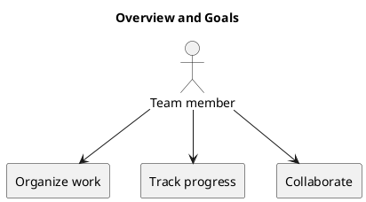

# Overview and Goals

KanbanFlow provides a shared view of task ownership and progress. Its goals are to organize work, support workflow columns and WIP limits, and keep collaboration close to tasks through comments, activity, and notifications.

Evaluate usability through the workspace-to-task journey, persisted changes after refresh, keyboard interaction, and mobile layouts. Numeric adoption and performance targets have not been established.

## Goal verification

| Goal | Observable evidence |
| --- | --- |
| Visible ownership | A task displays its assigned member after saving and refreshing. |
| Visible progress | Moving a task changes its workflow column and persists. |
| Controlled active work | A move into a full WIP-limited column is rejected with feedback. |
| Usable navigation | A user can reach workspaces, projects, and boards with keyboard navigation. |

These checks describe acceptance targets; dated results belong in release validation.

## PlantUML diagram

[Standalone source](diagrams/overview-and-goals.puml)

