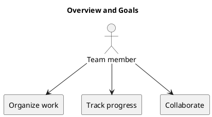

# Overview and Goals

KanbanFlow provides a shared view of task ownership and progress. Its goals are to organize work, support workflow columns and WIP limits, and keep collaboration close to tasks through comments, activity, and notifications.

Evaluate usability through the workspace-to-task journey, persisted changes after refresh, keyboard interaction, and mobile layouts. Numeric adoption and performance targets have not been established.

## PlantUML diagram

[Standalone source](diagrams/overview-and-goals.puml)

