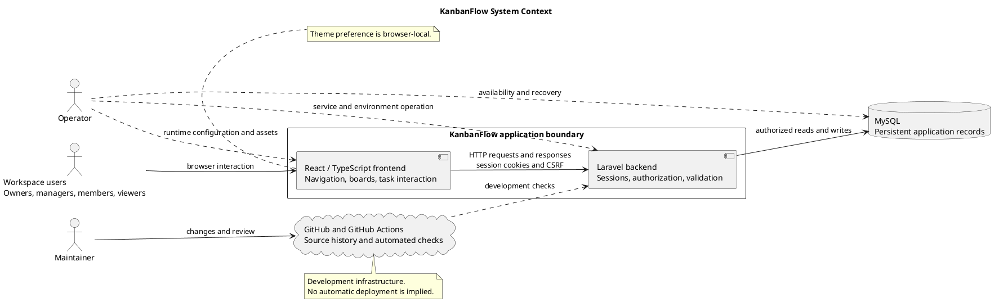

# KanbanFlow Project Context

> **Policy amendment (2026-10-10):** Membership mutations are now owner-only; DEC-003/PB-001's bypass is fixed. Current guidance below reflects this rule; historical records retain their original scope. See [QA corrections](../SDLC/06-testing/qa-corrections-2026-10-10.md) for the selected rule and regression evidence.

## Purpose

This document locates KanbanFlow among its users, supporting services, and development infrastructure. It explains the major interaction and responsibility boundaries without prescribing a hosting provider or deployment topology.

The diagram is a high-level context view with the frontend and backend shown inside the application boundary. It is not a complete component, database, endpoint, or network diagram.

## System of interest

KanbanFlow is a browser-based application for workspace collaboration, project organization, and Kanban task workflows. Its frontend presents boards and user interactions; its backend authenticates requests, checks permissions, validates changes, and accesses persistent records.

The application boundary includes the React/TypeScript frontend and Laravel backend. MySQL is shown as the supporting persistence service used in the documented application setup. GitHub and GitHub Actions support development rather than ordinary task-management requests.

## Actors and responsibilities

| Actor | Interaction or responsibility |
| --- | --- |
| Workspace owner | Uses the application to organize work and administer permitted membership operations. |
| Manager | Coordinates work within backend-enforced permissions. |
| Member | Contributes to tasks and collaboration within permitted resources. |
| Viewer | Inspects permitted workspace information. |
| Maintainer | Changes source, reviews implementation, and examines automated verification. |
| Operator | Configures and runs services, maintains database availability, and plans recovery. |

Responsibilities are distinct from a complete authorization matrix. Membership additions, removals, and role changes are owner-only under DEC-003/PB-001; the 2026-10-10 correction closes the manager remove/re-add bypass.

## Systems and boundaries

| Boundary | Included behavior | Important limit |
| --- | --- | --- |
| User to frontend | Browser interaction, navigation, forms, and board workflows. | Browser usability requires runtime verification. |
| Frontend to backend | API requests and responses, session authentication, validation feedback. | URLs, stateful origins, cookies, and CSRF must be configured consistently. |
| Backend to database | Persistent users, membership, projects, boards, tasks, and related records. | Data access and integrity must be enforced by backend logic and database operations. |
| Maintainer to GitHub | Source history, review, and automated checks. | GitHub availability is not required for an already-running application's ordinary task requests. |
| Operator to runtime | Configuration, assets, service operation, and recovery preparation. | A published source release does not demonstrate production deployment or restore capability. |

The browser stores theme preference locally. This preference is not represented as shared account data synchronized across devices.

## Main interaction flows

### Authentication

A user submits registration or sign-in through the frontend. The frontend and backend participate in the configured Sanctum session/CSRF flow. Subsequent protected requests depend on the authenticated session and backend authorization.

Authentication failures, expired sessions, validation errors, and unavailable services must produce understandable feedback. Correct deployment-specific origins and cookie settings are prerequisites, not details the context diagram can guarantee.

### Task management and collaboration

A permitted user opens a workspace, project, and board. The frontend requests resource data from the backend. The backend checks access and reads the configured database.

Changes such as creating, assigning, commenting on, or moving a task are validated and persisted by the backend. Failed requests must not leave the frontend presenting rejected changes as accepted. Ordering and WIP limits need appropriate transaction and contention verification.

### Development and verification

Maintainers submit source changes through Git. GitHub Actions runs the configured backend tests and frontend lint/build for main pushes and pull requests targeting main. Those checks do not automatically deploy services or establish browser usability.

### Operation and recovery

Operators supply runtime configuration, database connectivity, and service availability. Backup, retention, restore, capacity, and deployment decisions require their own operational evidence. A code checkout does not restore application data.

## Data and trust boundaries

- Credentials and session state cross the browser/backend authentication boundary; do not place secrets in diagrams or documentation.
- Workspace membership, board visibility, and resource permissions must be enforced by the backend, even when frontend controls are hidden.
- Database records contain application and user information; operational access and backups require appropriate protection.
- Browser-local preferences are separate from persisted collaborative work.
- Development logs and verification artifacts should avoid exposing credentials or personal data.

This document describes architectural responsibilities, not a security certification or a promise that every threat has been tested.

## Exclusions and open decisions

The view does not promise offline editing, a guaranteed real-time synchronization service, external task integrations, billing, or email/SMS delivery. Current notification documentation describes database notifications.

Hosting topology, numerical availability/capacity targets, recovery objectives, and a supported browser matrix remain operational decisions. Membership additions, removals, and role changes are owner-only under DEC-003/PB-001; the 2026-10-10 correction closes the manager remove/re-add bypass.

## Diagram notation

Solid arrows represent application interaction or source-management interaction. Dashed arrows represent development or operational responsibility. They do not imply a specific deployment transport, executable deployment pipeline, or automatic production changes.

## Related evidence

- [API routes](../../backend/routes/api.php)
- [Sanctum configuration](../../backend/config/sanctum.php)
- [CI workflow](../../.github/workflows/ci.yml)
- [Overview and goals](overview-and-goals.md)
- [Stakeholders and external systems](stakeholders-and-external-systems.md)
- [Assumptions and constraints](assumptions-and-constraints.md)
- [Scope boundary](scope-boundary-diagram.md)
- [Upgrade and rollback guidance](../Releases/upgrade-and-rollback.md)

Review this context when system boundaries, integrations, authentication, deployment responsibilities, or scope change. Keep the PlantUML source and preview synchronized.

## PlantUML diagram

[Editable source](diagrams/project-context-diagram.puml)

