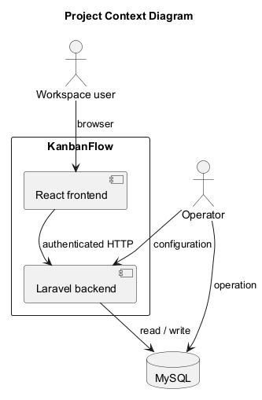
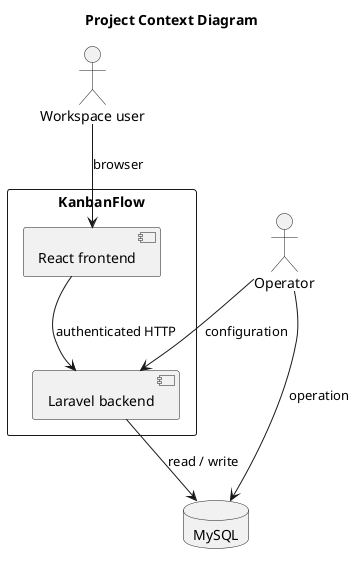

# Project Context Diagram

KanbanFlow is the system of interest. Its application boundary includes the React frontend and Laravel backend. Users interact through a browser; the backend authorizes requests and accesses MySQL.

Maintainers use GitHub and CI during development. Operators manage runtime configuration and database availability. This context view does not prescribe a hosting provider, deployment topology, or live-update transport.

## How to read the diagram

The application box identifies the frontend and backend boundary. Solid arrows show interaction or operational responsibility. MySQL is a supporting persistence service. This diagram does not model every endpoint or hosting component.

See [stakeholders and external systems](stakeholders-and-external-systems.md) for development-service relationships.

## PlantUML diagram

[Standalone source](diagrams/project-context-diagram.puml)

