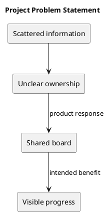

# Project Problem Statement

The working problem hypothesis is that scattered task information obscures ownership, priorities, and progress. Customer research validating this hypothesis is not recorded here.

KanbanFlow responds with shared boards, explicit workflow columns, assigned tasks, comments, and activity history. The intended benefit is that teams can inspect work without reconstructing its state from separate conversations. Validate this benefit through observed user journeys.

## PlantUML diagram

[Standalone source](diagrams/project-problem-statement.puml)

