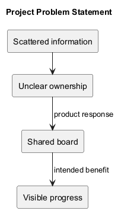
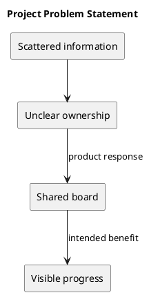

# Project Problem Statement

The working problem hypothesis is that scattered task information obscures ownership, priorities, and progress. Customer research validating this hypothesis is not recorded here.

KanbanFlow responds with shared boards, explicit workflow columns, assigned tasks, comments, and activity history. The intended benefit is that teams can inspect work without reconstructing its state from separate conversations. Validate this benefit through observed user journeys.

## Users and problem validation

The intended users are teams that organize work in shared projects. Validate the problem by observing how they currently discover task ownership, update progress, and handle blocked work. Record observations before setting measurable productivity claims.

## Success signal

A user can identify a task's owner and current workflow stage from the board, then update the task without losing saved state.

## PlantUML diagram

[Standalone source](diagrams/project-problem-statement.puml)

