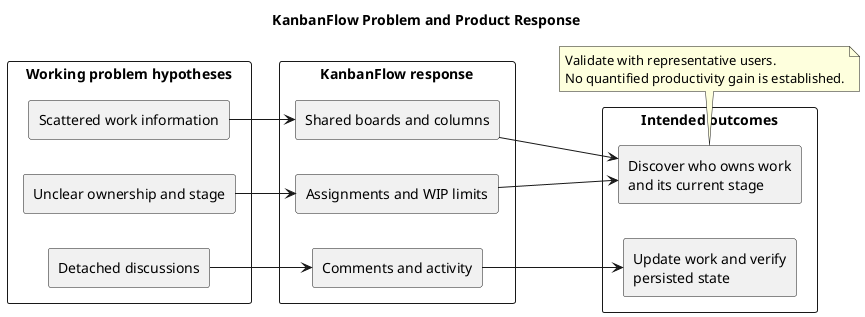

# KanbanFlow Project Problem Statement

> **Policy amendment (2026-10-10):** Membership mutations are now owner-only; DEC-003/PB-001's bypass is fixed. Earlier open-policy text and diagrams below describe the preceding state. See [QA corrections](../SDLC/06-testing/qa-corrections-2026-10-10.md) for the selected rule and regression evidence.

## Core problem

Teams organizing shared project work need to discover what tasks exist, who owns them, and where they sit in the workflow. When work information is scattered across notes, lists, and separate conversations, answering these questions can require manual reconstruction.

This is KanbanFlow's working problem hypothesis. Customer interviews, adoption studies, and quantified productivity improvements are not recorded in this document. The implemented application demonstrates a proposed response; it does not by itself validate the hypothesis.

## Context and affected users

KanbanFlow targets users who organize work through shared projects and task workflows.

| Stakeholder | Information need |
| --- | --- |
| Workspace owner | Understand workspace activity and administer membership. |
| Manager | Coordinate work and inspect priorities within permitted resources. |
| Member | Find assigned work, update its stage, and discuss it with collaborators. |
| Viewer | Inspect permitted progress without requiring management actions. |
| Maintainer or operator | Keep the application reliable, understandable, and supportable. |

Actual resource permissions are enforced by the backend. These user needs are not a complete authorization specification.

## Problem hypotheses and consequences

| Hypothesis | Possible consequence | Evidence to collect |
| --- | --- | --- |
| Work is recorded in disconnected places | Users cannot reliably find the current task list. | Observe how users locate and reconcile work. |
| Ownership is unclear | Users need additional communication to identify responsibility. | Observe task handoffs and ownership questions. |
| Workflow stage is hard to inspect | Progress is reported manually or becomes outdated. | Compare reported state with actual task state. |
| Discussions are detached from tasks | Context is lost when users return to the work. | Observe how users retrieve decisions and updates. |
| Too much work is active simultaneously | Teams struggle to identify overload. | Observe active-work policies and responses to limits. |

These consequences are hypotheses to investigate, not measured findings about existing users.

## Product response

| Need | KanbanFlow capability | Intended benefit |
| --- | --- | --- |
| Shared organization | Workspaces, projects, and boards | A common place to inspect related work. |
| Visible workflow | Ordered columns and tasks | Task stage and order can be inspected directly. |
| Clear ownership | Task assignment | Users can identify the assigned member. |
| Active-work control | Optional WIP limits | Applicable limits constrain additional active work. |
| Task context | Comments and activity history | Discussion and change context remain close to work. |
| Progress awareness | Database notifications and workspace analytics | Users can inspect relevant updates and summaries. |
| Understandable interaction | Search, navigation, themes, validation, and recovery feedback | Users can locate work and understand action outcomes. |

These capabilities are described in the [overview](overview-and-goals.md) and [project README](../../README.md). Consult release records for historical delivery and validation.

## Representative user journey

1. Sign in and open a permitted workspace.
2. Select a project and board.
3. Locate a task and identify its assigned member and workflow stage.
4. Inspect relevant comments or activity.
5. Make a permitted update or move.
6. Confirm that the accepted change persists after refresh.
7. If the action fails, understand the feedback and see the server's accepted state.

This journey gives problem validation a concrete observation target. It does not assume that every role may perform every action.

## Success signals and evaluation

| Signal | Observation |
| --- | --- |
| Findability | A representative user locates the relevant task without assistance. |
| Ownership clarity | The user identifies the assigned member or recognizes that the task is unassigned. |
| Progress clarity | The user identifies the current workflow column and interprets it correctly. |
| Reliable updates | Accepted changes remain visible after refresh. |
| Error understanding | The user understands a rejected action and can choose a next step. |
| Collaboration context | Relevant discussion can be found from the task workflow. |

Record the scenario, environment, tested commit, user observations, and difficulties. Establish a baseline before setting numerical time-saving, adoption, satisfaction, or performance targets. Test counts alone do not demonstrate these outcomes.

## Validation approach

- Observe current task discovery, handoffs, and progress reporting before proposing productivity claims.
- Run representative journeys with authorized test accounts and isolated data.
- Include empty states, unassigned tasks, permission denials, failed requests, and WIP rejection.
- Check keyboard interaction and narrow layouts when evaluating usability.
- Separate user observations from automated correctness checks and historical release evidence.
- Feed confirmed difficulties into the [product backlog](../Project-Management/product-backlog.md).

No participant identities, research results, dates, or numerical outcomes should be invented to fill this plan.

## Boundaries and limitations

KanbanFlow does not promise to replace organizational decision-making, eliminate all communication, or guarantee productivity improvements. Billing, payroll, time tracking, offline editing, external task synchronization, and email/SMS delivery are outside the current working scope.

Shared software can make information visible, but task quality, workflow naming, ownership decisions, and regular updates still depend on team practices. Database availability, session configuration, and reliable mutation handling affect the user experience.

The manager remove/re-add role-change loophole remains unresolved. Do not treat intended owner-only role changes as fully enforced until the policy is agreed and regression-verified.

## Related definitions and maintenance

- [Overview and goals](overview-and-goals.md)
- [Scope and stakeholders](scope-and-stakeholders.md)
- [System context](project-context-diagram.md)
- [Assumptions and constraints](assumptions-and-constraints.md)
- [Risks and success criteria](risks-and-success-criteria.md)
- [Release history](../Releases/README.md)

Update this statement when user evidence, target users, or scope changes. Keep hypotheses distinct from validated findings and regenerate diagram previews after source edits.

## PlantUML diagram

[Editable source](diagrams/project-problem-statement.puml)

