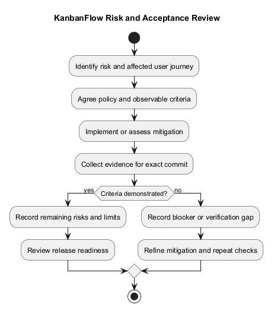
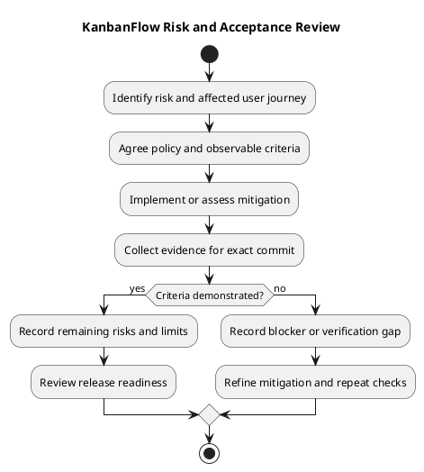

# KanbanFlow Risks and Success Criteria

## Purpose and assessment boundary

This document connects material project risks to observable acceptance criteria and verification evidence. It supports planning and release review; it is not a security certification, service-level agreement, or assertion that all scenarios have passed.

The manager membership loophole is a confirmed known issue. Other entries describe failure modes that require prevention and proportionate verification when affected. No statistical likelihood scores, financial estimates, named owners, or target dates have been agreed here.

## Risk register

| ID | Risk and trigger | Potential impact | Response and verification | Current position |
| --- | --- | --- | --- | --- |
| R-01 | A manager removes and re-adds a member with a different role | Intended owner-only role changes can be bypassed. | Agree permitted manager operations; enforce them in the backend and verify both direct and indirect role-change paths. | Open policy decision and known defect. |
| R-02 | Frontend/backend hosts, cookies, or stateful origins disagree | Sign-in or authenticated actions fail. | Review environment configuration; verify registration, login, logout, expired sessions, and existing-session redirects. | Configuration-sensitive boundary; earlier defaults were corrected in v1.0.2. |
| R-03 | Concurrent task or column changes contend for positions or WIP capacity | Invalid ordering, stale updates, or excess active work. | Preserve transactional enforcement and stale-state checks; run relevant regression and isolated MySQL contention scenarios. | Requires targeted checks when affected; SQLite alone is insufficient. |
| R-04 | A mutation fails after an optimistic UI update | User sees a rejected change as accepted. | Verify clear feedback, rollback, cache refresh, and persisted state after reload. | Verify affected mutation paths. |
| R-05 | Access checks are missing on nested resources or visibility-sensitive feeds | Unauthorized information disclosure or modification. | Verify workspace membership, private-board visibility, and task/comment access through backend requests. | Security-critical regression boundary. |
| R-06 | Keyboard, mobile, focus, or theme regressions occur | Users cannot complete core interactions reliably. | Exercise keyboard dialogs and movement, focus restoration, narrow layouts, and theme persistence. | Browser checks required when affected. |
| R-07 | Data is lost or configuration becomes incompatible during operation | Work cannot be recovered or services become unavailable. | Preserve configuration and data, assess upgrade compatibility, and verify backup/restore procedures in isolation. | Production recovery objectives and demonstrated restore evidence are not established here. |
| R-08 | Documents, diagram previews, and release claims drift from source | Users or operators follow misleading guidance. | Check links, source/preview consistency, release identity, and historical versus fresh evidence. | Ongoing maintenance responsibility. |
| R-09 | Capacity or availability is assumed without measurement | Deployment expectations exceed demonstrated behavior. | Agree targets and measure in the intended environment before commitments. | No numerical guarantees established. |

Security, data integrity, and recovery consequences should guide review priority. Priority is a planning judgment rather than a measured probability.

## Proposed success and acceptance criteria

| ID | Criterion | Passing observation | Required evidence |
| --- | --- | --- | --- |
| SC-01 | Workspace-to-task journey | An authorized user can create or open the permitted hierarchy and save a task. | Browser journey and relevant backend checks. |
| SC-02 | Persistent state | Accepted edits, assignments, and moves remain correct after refresh. | Saved-record assertions and refresh observations. |
| SC-03 | Authorization | Resource access follows the agreed membership and visibility policy, including rejected direct requests. | Backend authorization regression checks; R-01 must be closed before claiming the owner-only rule is complete. |
| SC-04 | WIP and ordering | Applicable limits reject invalid moves; ordered records remain valid under relevant competing operations. | Backend tests, browser rollback, and isolated MySQL contention evidence. |
| SC-05 | Collaboration | Permitted users can inspect saved comments, activity, and relevant notifications; denied users cannot. | Collaboration journeys and access checks. |
| SC-06 | Failure recovery | Validation, session, connection, and server failures produce understandable feedback without false saved state. | Affected error and retry scenarios. |
| SC-07 | Usability and accessibility | Core affected journeys work with a keyboard and narrow layouts; themes remain readable and preferences persist. | Browser evidence tied to the changed views. |
| SC-08 | Engineering checks | Relevant backend tests, frontend lint, type checks, and build pass for the candidate. | Exact commands, CI result, tested commit, and environment. |
| SC-09 | Documentation correctness | Referenced files exist and diagrams and claims match their sources. | Link checks, PlantUML rendering, and scoped review. |
| SC-10 | Operational readiness | Deployment and recovery requirements are defined and demonstrated for the target environment before operational claims. | Authorized deployment checks and isolated recovery evidence. |

These criteria are targets for verification, not fresh pass results. Numeric productivity, adoption, response-time, uptime, and capacity targets require agreed baselines and measurement.

## Risk-to-criterion traceability

| Risks | Primary criteria |
| --- | --- |
| R-01, R-05 | SC-03, SC-05 |
| R-02 | SC-01, SC-06 |
| R-03 | SC-02, SC-04 |
| R-04 | SC-02, SC-06 |
| R-06 | SC-07 |
| R-07, R-09 | SC-10 |
| R-08 | SC-09 |
| All affected changes | SC-08 plus relevant behavior criteria |

Passing a general build or unrelated test does not close a risk whose failure boundary was not exercised.

## Evidence requirements

For each verification record, identify:

- Exact commit and release candidate or tag.
- Environment, runtime versions, database engine, browser, and isolated test setup.
- Scenarios, commands, results, and supporting logs or links.
- Failures, skipped checks, and unverified assumptions.
- Known issues, mitigation, and the next required decision or action.

Backend tests use [in-memory SQLite](../../backend/phpunit.xml). They do not prove MySQL lock behavior or contention safety. [CI](../../.github/workflows/ci.yml) runs backend tests and frontend lint/build; it does not automatically establish accessibility, browser journeys, deployment, or recovery.

Use the [release verification template](../Releases/verification-template.md). Historical release test counts remain historical; do not reuse them as evidence for a newly changed commit.

## Open membership decision

Determine which roles managers may add or remove, whether they may assign roles when adding members, and how removal/re-addition must preserve intended owner-only restrictions. Document the chosen policy before implementation.

Closure requires backend enforcement and regression coverage of direct role updates, removal, re-addition, current membership, and relevant owner protections. Until then, owners should manage membership. Track the decision in the [decision register](../Project-Management/decision-register.md) and the work in the [product backlog](../Project-Management/product-backlog.md).

## Release review and residual risk

Before release, review the relevant criteria against fresh evidence. Record unresolved issues and their user impact in the release notes. Unmet security, data-integrity, or recovery criteria require an explicit review decision; do not silently mark them passed.

A published source release does not imply production deployment, operational targets, or restore capability. Follow the [release checklist](../Releases/release-checklist.md) and [upgrade/rollback guidance](../Releases/upgrade-and-rollback.md).

## Maintenance and related definitions

Review this register when permissions, authentication, ordering, persistence, deployment, or user journeys change. Add confirmed defects with reproduction evidence and retain clear distinctions between open risks and resolved behavior.

- [Overview and goals](overview-and-goals.md)
- [Assumptions and constraints](assumptions-and-constraints.md)
- [Problem statement](project-problem-statement.md)
- [Quality and risk plan](../Project-Management/quality-and-risk-plan.md)
- [Published release records](../Releases/README.md)

## PlantUML diagram

[Editable source](diagrams/risks-and-success-criteria.puml)

