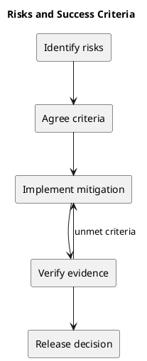

# Risks and Success Criteria

| Risk | Response |
| --- | --- |
| Manager remove/re-add bypasses role restrictions | Agree the membership policy and verify backend enforcement. |
| Session configuration prevents login | Verify authentication and existing-session redirects. |
| Concurrent moves violate WIP or ordering | Preserve transactional enforcement and relevant concurrency checks. |
| Failed mutations leave misleading UI state | Verify rollback and persisted state after refresh. |
| Documentation drifts | Review affected documents with implementation changes. |

Proposed acceptance criteria: complete the workspace-to-task journey; persist changes after refresh; enforce agreed role rules and WIP limits; support keyboard and narrow-screen use; and pass relevant lint, type, build, and backend checks. These are verification targets, not a claim that all risks are resolved.

## PlantUML diagram

[Standalone source](diagrams/risks-and-success-criteria.puml)

