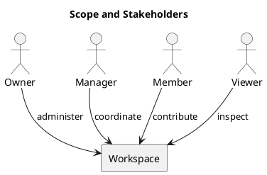

# Scope and Stakeholders

Included capabilities are account authentication, workspace membership, projects, boards, columns, tasks, assignments, due dates, comments, activity, database notifications, and analytics.

Owners administer workspaces; managers coordinate permitted work; members contribute; viewers inspect permitted information. Maintainers develop the application and operators run its services.

The known manager remove/re-add role-change loophole remains unresolved pending a membership-policy decision. UI visibility alone is not authorization.

## PlantUML diagram

[Standalone source](diagrams/scope-and-stakeholders.puml)

