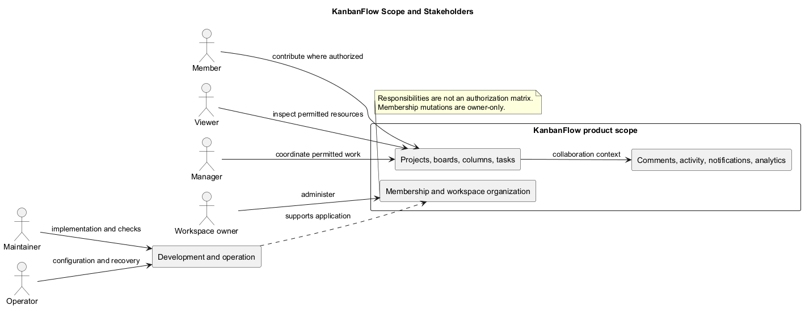
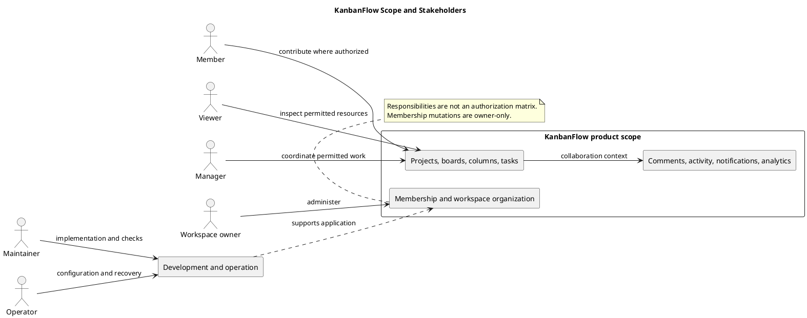

# KanbanFlow Scope and Stakeholders

> **Policy amendment (2026-10-10):** Membership mutations are now owner-only; DEC-003/PB-001's bypass is fixed. Current guidance below reflects this rule; historical records retain their original scope. See [QA corrections](../SDLC/06-testing/qa-corrections-2026-10-10.md) for the selected rule and regression evidence.

## Purpose

This document defines the current working product boundary and the people who use, maintain, or operate KanbanFlow. It separates delivered capabilities, stakeholder responsibilities, exclusions, and unresolved policy decisions.

Responsibilities described here are not a complete authorization matrix or a record of named project assignments. Backend policies and resource access checks determine actual permitted actions.

## Included product scope

| Area | Included capabilities | Boundary |
| --- | --- | --- |
| Accounts and sessions | Registration, login, logout, authenticated-user access, and protected routes. | Correct session, cookie, origin, and CSRF configuration is required. |
| Workspaces and membership | Workspace organization and owner, manager, member, and viewer membership roles. | All membership mutations are owner-only; the bypass is corrected under DEC-003/PB-001. |
| Projects and boards | Project organization, board visibility, ordered boards, and resource-list search. | Visibility and nested resource access must be enforced by the backend. |
| Workflow columns | Ordered stages and optional WIP limits. | Limits and ordering require appropriate integrity and contention checks. |
| Tasks | Creation, editing, priorities, descriptions, due dates, assignments, completion, and movement. | Management and contribution actions depend on authorization. |
| Collaboration | Comments, activity history, database notifications, and workspace analytics. | Information is scoped to permitted resources; email/SMS delivery is not promised. |
| Interface | Navigation, themes, responsive layouts, validation feedback, keyboard interaction, and error recovery. | Browser behavior requires runtime verification, not build success alone. |

The [project README](../../README.md) describes implemented features. The [release records](../Releases/README.md) identify published history; later main commits do not automatically constitute a new release.

## Work and data boundaries

The collaboration hierarchy is workspace, project, board, column, and task. Membership establishes a workspace access context, while board visibility and nested-resource rules add further restrictions.

Task-related comments, activity, notifications, and summaries must respect applicable access rules. Frontend controls assist navigation and feedback; they cannot replace backend authorization.

Browser-local theme preferences are separate from shared work records. Database availability and accepted backend mutations determine whether collaborative changes persist.

## Stakeholder register

| Stakeholder | Need or interest | Responsibility | Participation |
| --- | --- | --- | --- |
| Workspace owner | Controlled workspace organization and membership | Make membership decisions and administer permitted workspace operations. | Clarify membership policy and validate administration journeys. |
| Manager | Coordinated work and visible progress | Coordinate resources within backend-enforced permissions. | Validate management flows and policy consequences. |
| Member | Clear assignments and task context | Contribute to permitted work and maintain task information. | Exercise assignment, movement, and collaboration journeys. |
| Viewer | Readable, permitted progress information | Inspect resources available to the role. | Validate read-only journeys and access denials. |
| Maintainer | Correct, reviewable implementation | Implement changes, review source, and record verification evidence. | Assess dependencies, regressions, and documentation impacts. |
| Operator | Available services and recoverable data | Configure runtime, database access, backups, and recovery processes. | Review deployment requirements and operational checks. |

These are stakeholder categories. Names, staffing, dates, approval authority, and organizational reporting lines have not been assigned in this document.

## Responsibility versus permission

A responsibility explains a stakeholder's intended contribution. A permission specifies which action the system allows on a resource. Do not infer an allowed action from a role description alone.

Examples requiring backend verification include private-board access, nested task/comment requests, membership changes, removed-member access, and workspace-scoped analytics. The known manager removal/re-addition path must be assessed alongside direct role updates.

Only owners can mutate membership under the implemented rule. See the [decision register](../Project-Management/decision-register.md) for the recorded owner-only policy.

## Supporting systems and project activities

React/TypeScript and Laravel provide the application interface and backend. MySQL is the documented application database. GitHub and GitHub Actions support source management and automated checks.

Development review, testing, documentation, release preparation, and operational guidance are project activities that support delivery. They are not user-facing integrations. A GitHub release does not prove production deployment or backup restoration.

See [system context](project-context-diagram.md) and [external systems](stakeholders-and-external-systems.md).

## Excluded from the current working definition

- Billing, payroll, and time tracking.
- Offline task editing.
- Third-party task synchronization.
- Guaranteed real-time multi-user synchronization.
- Email or SMS notification delivery.
- Numerical availability, capacity, performance, or productivity guarantees.

These exclusions describe current scope, not a permanent prohibition on future features. Any addition needs agreed requirements, affected users, data boundaries, permission rules, and verification criteria.

## Open decisions and dependencies

| Topic | Needed decision or evidence |
| --- | --- |
| Future manager membership delegation | Requires a new explicit safe policy and direct/indirect regression coverage; current mutations are owner-only. |
| Browser support | Agree the supported matrix and verify relevant browser and keyboard journeys. |
| Operational readiness | Define hosting, recovery objectives, backups, and restore evidence before production claims. |
| Product success targets | Establish user observations and baselines before numerical commitments. |

Track candidate improvements in the [product backlog](../Project-Management/product-backlog.md). Do not interpret roadmap proposals as scheduled commitments.

## Scope-change process

1. State the user problem and the affected stakeholders.
2. Identify current behavior and the proposed addition or change.
3. Assess API, data, authorization, compatibility, and operational impacts.
4. Agree acceptance criteria and unresolved decisions.
5. Record the decision and update relevant definitions, diagrams, and backlog items.
6. Implement and verify the scoped change before recording it as delivered.

No new feature or policy is approved merely by adding it to documentation.

## Acceptance and review

Validate included scope through representative permitted journeys and direct denied-access checks. Link results to an exact commit and environment. Use the [risk and success criteria](risks-and-success-criteria.md) to identify material failure boundaries.

Review this document when capabilities, role rules, integrations, or operational responsibilities change. Keep exclusions and open decisions visible and synchronize the PlantUML source and preview.

## Related definitions

- [Overview and goals](overview-and-goals.md)
- [Scope boundary diagram](scope-boundary-diagram.md)
- [Assumptions and constraints](assumptions-and-constraints.md)
- [Problem statement](project-problem-statement.md)

## PlantUML diagram

[Editable source](diagrams/scope-and-stakeholders.puml)

