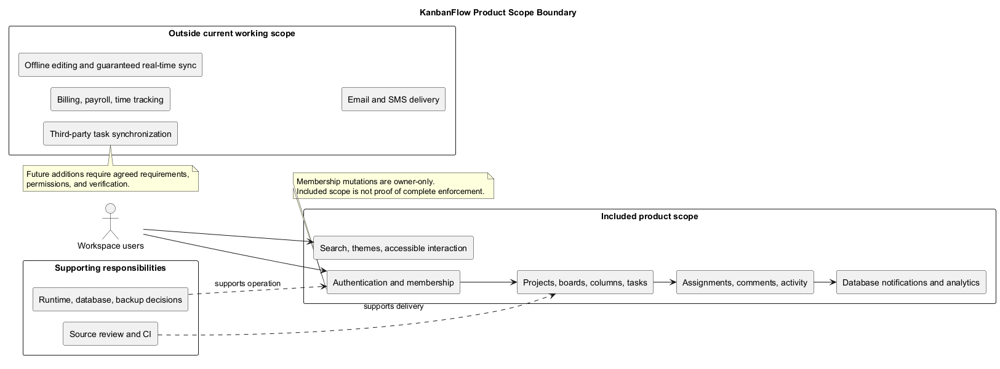
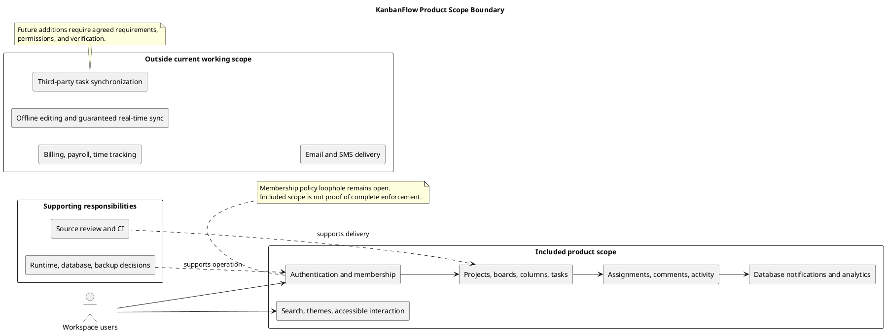

# KanbanFlow Scope Boundary Diagram

> **Policy amendment (2026-10-10):** Membership mutations are now owner-only; DEC-003/PB-001's bypass is fixed. Earlier open-policy text and diagrams below describe the preceding state. See [QA corrections](../SDLC/06-testing/qa-corrections-2026-10-10.md) for the selected rule and regression evidence.

## Purpose and interpretation

This document shows which capabilities belong to KanbanFlow's current working product definition, which responsibilities support it, and which capabilities are excluded. It complements the [system context](project-context-diagram.md): a system boundary describes components and interactions, while a scope boundary describes the work the product is intended to cover.

Included scope does not mean every behavior is defect-free or freshly verified. Exclusion does not permanently prohibit a future feature. No new requirement is approved merely because it is mentioned here.

## Included capabilities

| Area | Included scope | Boundary condition |
| --- | --- | --- |
| Authentication | Registration, login, logout, authenticated sessions, and protected routes. | Requires correctly configured origins, cookies, and CSRF behavior. |
| Workspace organization | Workspaces, membership roles, and permitted management operations. | Manager remove/re-add can bypass intended owner-only role changes; policy and enforcement remain open. |
| Project organization | Projects and boards, visibility, ordering, and list search. | Backend access rules apply to direct and nested requests. |
| Workflow | Ordered columns, tasks, movement, and optional WIP limits. | Valid ordering and applicable limits must survive relevant concurrent operations. |
| Task details | Priorities, descriptions, due dates, assignments, and completion state. | Changes must be accepted and persisted by the backend. |
| Collaboration | Comments, activity history, database notifications, and workspace analytics. | Information must respect permitted workspace and board access. |
| Interface | Navigation, responsive layouts, Light/Dark/System themes, keyboard interaction, validation, and recovery feedback. | Browser usability and failure recovery require runtime checks. |

Consult the [overview](overview-and-goals.md) and [project README](../../README.md) for product behavior. Use [release records](../Releases/README.md) for published history rather than treating all current main commits as a release.

## Outside the current working definition

| Capability | Exclusion and implication |
| --- | --- |
| Billing and payroll | No billing, payment, or payroll workflow is promised. |
| Time tracking | Task management is not a time-accounting service. |
| Offline editing | Saved collaborative work depends on available application services and accepted requests. |
| Guaranteed real-time synchronization | No transport or cross-user update guarantee is established here. |
| Third-party task synchronization | No external task-system integration is promised by this definition. |
| Email or SMS delivery | Current notification scope describes database notifications. |
| Numerical service guarantees | Availability, capacity, response-time, and productivity commitments require agreed targets and measurement. |

These exclusions are planning boundaries rather than assertions about all possible future architecture.

## Supporting responsibilities

Source review, automated checks, documentation, release preparation, runtime configuration, database operation, and recovery planning support the product. They are separate from user-facing capabilities.

GitHub and GitHub Actions support development. Current CI runs backend tests and frontend lint/build, without automatically deploying the application. Publishing a GitHub release does not establish production availability or backup restoration.

Operators must define deployment-specific settings, data protection, backup ownership, and recovery evidence before making operational claims. See [upgrade and rollback guidance](../Releases/upgrade-and-rollback.md).

## Permission and data boundaries

- Workspace membership and board visibility restrict resource access.
- Nested tasks, comments, activity, and summaries must respect applicable backend authorization.
- Hidden frontend controls cannot substitute for direct-request enforcement.
- Browser-local theme preferences are separate from persistent shared work data.
- Rejected mutations must not leave the interface presenting unsaved changes as accepted.
- Code rollback does not automatically reverse database changes or restore records.

The diagram describes scope; it is not a complete role/action matrix, database model, or security certification.

## Open decisions and assumptions

The manager membership policy remains undecided. Define allowed add/remove and role-assignment behavior, then test direct and indirect role changes before treating owner-only restrictions as complete.

Supported browser coverage, hosting topology, recovery objectives, and numerical capacity targets require explicit decisions and environment evidence. Review [assumptions and constraints](assumptions-and-constraints.md) before broadening claims.

## Scope-change process

1. State the user problem and affected stakeholders.
2. Describe the proposed behavior and its relationship to existing scope.
3. Assess data, API, permissions, compatibility, and operational dependencies.
4. Define observable acceptance criteria and required verification.
5. Record the agreed decision and update scope, backlog, and related diagrams.
6. Implement and verify the change against an exact commit.
7. Record delivered behavior and limitations in the relevant release documentation.

Track candidate changes in the [product backlog](../Project-Management/product-backlog.md) and decisions in the [decision register](../Project-Management/decision-register.md). Proposed work is not a dated delivery commitment.

## Acceptance and evidence

Verify included journeys and affected denied-access paths using isolated data. Match check depth to risk: static checks and build results do not establish browser usability, MySQL contention, deployment, or recovery correctness.

Use the [risk and success criteria](risks-and-success-criteria.md) and [verification template](../Releases/verification-template.md) to record results, exact commit/environment, failures, and unverified boundaries.

## Diagram notation and maintenance

The included box contains product capabilities. Supporting responsibilities are shown separately with dashed relationships. The excluded box records planning boundaries and has no integration arrows, since no implementation of those capabilities is promised.

Review this boundary whenever product scope, role policy, integrations, or operational commitments change. Keep the editable PlantUML source and rendered preview synchronized.

## Related documents

- [Scope and stakeholders](scope-and-stakeholders.md)
- [Problem statement](project-problem-statement.md)
- [Stakeholders and external systems](stakeholders-and-external-systems.md)

## PlantUML diagram

[Editable source](diagrams/scope-boundary-diagram.puml)

