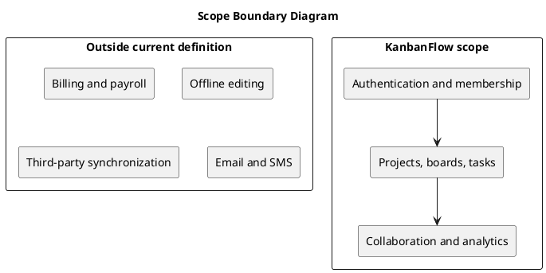

# Scope Boundary Diagram

Inside scope: application authentication, workspace collaboration, project planning, board workflows, task management, comments, activity, database notifications, and analytics.

Outside this working definition: billing, payroll, time tracking, third-party synchronization, offline editing, and email/SMS delivery. This planning boundary does not prevent future additions.

Before expanding scope, document the users, data, permission implications, and acceptance criteria of the proposed capability.

## Scope-change checklist

1. Identify the user problem and affected stakeholders.
2. Define the data and permission boundaries.
3. Record measurable acceptance criteria and operational dependencies.
4. Update this boundary and the requirements before delivery.

See [scope and stakeholders](scope-and-stakeholders.md) for the included capabilities and roles.

## PlantUML diagram

[Standalone source](diagrams/scope-boundary-diagram.puml)

