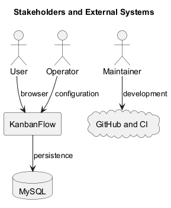
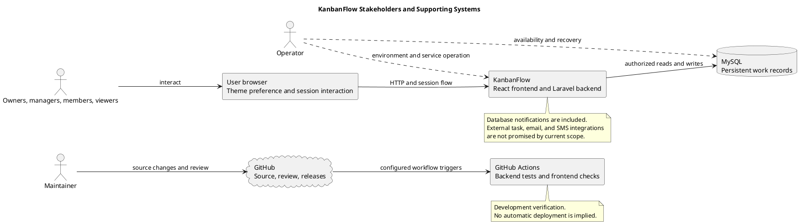

# KanbanFlow Stakeholders and External Systems

> **Policy amendment (2026-10-10):** Membership mutations are now owner-only; DEC-003/PB-001's bypass is fixed. Earlier open-policy text and diagrams below describe the preceding state. See [QA corrections](../SDLC/06-testing/qa-corrections-2026-10-10.md) for the selected rule and regression evidence.

## Purpose and boundary

This document identifies the people who use and support KanbanFlow, the systems they interact with, and the responsibilities at each boundary. It complements the [system context](project-context-diagram.md) and [scope definition](scope-and-stakeholders.md).

React and Laravel belong to the application boundary. The browser, configured database, source hosting, and automated-check infrastructure are described by their supporting roles. No external task-management, email, SMS, or payment integration is promised here.

## Stakeholder register

| Stakeholder | Main interest | Responsibility | Evidence or feedback needed |
| --- | --- | --- | --- |
| Workspace owner | Controlled membership and shared organization | Administer permitted workspace operations and clarify membership policy. | Administration journeys and policy decisions. |
| Manager | Coordinated tasks and visible progress | Coordinate work within backend-enforced permissions. | Management usability and denied-access scenarios. |
| Member | Clear assignments and collaboration context | Contribute to permitted tasks and keep work information current. | Assignment, movement, comments, and persistence observations. |
| Viewer | Readable permitted progress information | Inspect available resources without assuming management rights. | Read-only journeys and authorization checks. |
| Maintainer | Correct, reviewable, maintainable source | Implement changes, review, verify, and update documentation. | Commit-scoped tests, CI, and review evidence. |
| Operator | Configured services and recoverable data | Run services and define data protection and recovery procedures. | Environment, deployment, and isolated recovery evidence. |

These are stakeholder categories, not named staffing assignments or formal approval authority. Role responsibilities do not specify the complete set of allowed API operations.

## Application participants and systems

| System | Role | Boundary and limitation |
| --- | --- | --- |
| User browser | Presents the interface and participates in session requests. | Modern browser and network availability are assumed; theme preference is browser-local. |
| React/TypeScript frontend | Navigation, forms, board interaction, and feedback. | Inside KanbanFlow; UI controls do not replace authorization. |
| Laravel backend | Authentication, authorization, validation, and persistence operations. | Inside KanbanFlow; accepted backend state determines saved results. |
| MySQL | Documented application persistence service. | Operators must configure access, availability, and recovery; a source release is not a backup. |
| GitHub | Repository history, review, and release publication. | Development infrastructure rather than an ordinary task-request dependency. |
| GitHub Actions | Configured backend tests and frontend lint/build. | Triggered by main pushes and pull requests into main; no automatic deployment is established. |

Exact runtime and dependency requirements are recorded in manifests and lockfiles. See [Composer](../../backend/composer.json), [frontend package](../../frontend/package.json), and [CI configuration](../../.github/workflows/ci.yml).

## Interaction and information flows

| Flow | Information or action | Control requirement |
| --- | --- | --- |
| User to browser | Navigation, task input, and action selection. | Clear labels, validation, keyboard access, and readable layout. |
| Browser/frontend to backend | Authentication and resource requests with session/CSRF behavior. | Consistent hosts, origins, cookie settings, and backend access checks. |
| Backend to database | Users, membership, work records, comments, activity, notifications, and summaries. | Integrity, authorization, and appropriate transaction handling. |
| Maintainer to GitHub | Source changes, review records, and release notes. | Scoped changes and explicit publication authorization. |
| GitHub to Actions | Source checkout and configured checks. | Evidence tied to exact commits and workflow configuration. |
| Operator to runtime/database | Configuration, service operation, and recovery actions. | Environment-specific procedures and verified recovery planning. |

The diagram's solid arrows show interaction. Dashed arrows show operational responsibility, not an implemented automatic deployment pipeline.

## Authentication and trust boundaries

The browser and backend depend on a compatible Sanctum session and CSRF configuration. Deployment-specific frontend/backend URLs, stateful origins, and cookies must agree.

Backend authorization must cover direct and nested requests, including workspace membership and private-board visibility. Removed-member and role-change paths require their own checks. Sensitive data and credentials must not be copied into documentation, source commits, or verification artifacts.

The known manager remove/re-add loophole remains open. Owners should manage membership until the intended policy is decided and backend enforcement verified. See the [decision register](../Project-Management/decision-register.md).

## Availability and failure implications

- Application or network failure can prevent users from reading or saving work.
- Database failure affects persistent records; frontend optimistic state must not be treated as proof of a saved change.
- GitHub unavailability can interrupt source publication and CI but does not inherently stop an already-running application's ordinary task requests.
- Browser-local preference loss can reset theme selection without implying loss of shared database records.
- Recovery depends on operational procedures; no uptime, capacity, or restore guarantee is established in this document.

Verify relevant error feedback and persisted state against the actual environment.

## Systems outside current scope

Billing/payment services, payroll, time accounting, third-party task synchronization, email/SMS delivery, and guaranteed offline or real-time synchronization are not promised integrations.

Introducing an external system requires agreed user need, data exchanged, credentials, permission model, failure/retry behavior, compatibility, and operational responsibilities. Document those decisions before treating an integration as delivered.

## Stakeholder participation in change review

1. Identify the affected user roles and operational responsibilities.
2. Gather the user problem and desired outcome.
3. Assess data and permission effects across system boundaries.
4. Record open decisions and acceptance criteria.
5. Demonstrate affected behavior and denied-access paths with authorized test data.
6. Update documentation and release records with exact evidence and known limitations.

No customer interviews, participant approvals, dates, or research outcomes are inferred from this participation plan.

## Evidence and maintenance

[Backend tests](../../backend/phpunit.xml) use in-memory SQLite. They do not prove MySQL contention safety. CI checks do not establish browser usability or production recovery.

Use the [verification template](../Releases/verification-template.md) for exact commit/environment results. Review this document when roles, integrations, authentication, database responsibilities, or CI/deployment behavior changes. Regenerate the diagram preview whenever its source changes.

## Related definitions

- [Overview and goals](overview-and-goals.md)
- [Assumptions and constraints](assumptions-and-constraints.md)
- [Scope boundary](scope-boundary-diagram.md)
- [Risks and success criteria](risks-and-success-criteria.md)
- [Upgrade and rollback guidance](../Releases/upgrade-and-rollback.md)

## PlantUML diagram

[Editable source](diagrams/stakeholders-and-external-systems.puml)

