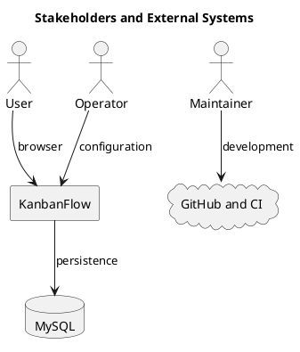

# Stakeholders and External Systems

Workspace users access KanbanFlow through a browser. React calls the Laravel backend, and MySQL persists records. Operators configure the runtime and database.

Maintainers use GitHub and GitHub Actions for source history and CI. GitHub is development infrastructure rather than a dependency for ordinary task requests. Current notifications are database notifications; email, SMS, and external integrations are not promised.

## PlantUML diagram

[Standalone source](diagrams/stakeholders-and-external-systems.puml)

