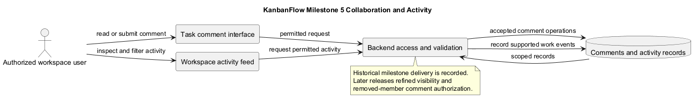
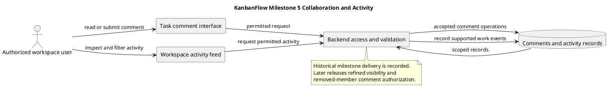

# Milestone 5 — Collaboration and Activity Tracking

> **Policy amendment (2026-10-10):** Membership mutations are now owner-only; DEC-003/PB-001's bypass is fixed. Earlier open-policy text and diagrams below describe the preceding state. See [QA corrections](../../SDLC/06-testing/qa-corrections-2026-10-10.md) for the selected rule and regression evidence.

## Historical status and source identity

**Recorded status: Completed.** The original milestone record states completion after PR #29 merged. The local Git history confirms that cc326c6 is the merge commit for the activity-feed frontend pull request.

- [Completion commit](https://github.com/Farhad-Valizadegan/Web-KanbanFlow/commit/cc326c6)
- [Milestone index](../milestones.md)

No completion date, named reviewer, or fresh test result is reconstructed here. This is a historical delivery record, not proof that every collaboration scenario is defect-free on current main.

## Purpose

Milestone 5 added task discussion and workspace activity history so permitted users could inspect collaboration context alongside work. Comments preserve discussion associated with tasks, while activity records make supported work events available through a workspace feed.

This intended benefit is not a measured productivity claim.

## Delivered scope described by the record

| Area | Historical outcome |
| --- | --- |
| Comments backend | Task comments with authorship, timestamps, validation, and authorization rules. |
| Comments frontend | User interface for task discussion and permitted comment operations. |
| Activity backend | Workspace-scoped recording of supported task/work operations. |
| Activity frontend | Workspace activity feed with filtering. |

The scope does not promise chat, external collaboration integrations, email/SMS delivery, or a guaranteed real-time update transport.

## Historical objectives

- Allow permitted workspace users to discuss tasks.
- Preserve comment authorship and timestamps.
- Restrict comment editing and deletion through backend authorization.
- Record important supported work operations in activity history.
- Provide an inspectable, filtered workspace activity feed.
- Verify affected backend behavior and frontend build compatibility.

The original text mentioned full test coverage, but it did not provide coverage measurement or check results. This expanded record does not turn that objective into a quantified coverage claim.

## Pull request sequence

| PR | Historical description | Reference |
| --- | --- | --- |
| #26 | Task comments backend | [PR #26](https://github.com/Farhad-Valizadegan/Web-KanbanFlow/pull/26) |
| #27 | Task comments frontend | [PR #27](https://github.com/Farhad-Valizadegan/Web-KanbanFlow/pull/27) |
| #28 | Workspace activity logging backend | [PR #28](https://github.com/Farhad-Valizadegan/Web-KanbanFlow/pull/28) |
| #29 | Workspace activity feed frontend | [PR #29](https://github.com/Farhad-Valizadegan/Web-KanbanFlow/pull/29) |

Descriptions are retained from the historical document. The completion commit identifies source integration, not production deployment or customer acceptance.

## Collaboration flow

1. A signed-in user opens a permitted workspace and task.
2. The frontend requests comments or submits a comment operation.
3. The backend checks current access and validates the request.
4. Accepted operations persist records and preserve associated authorship.
5. Supported work events are available through the activity feed.
6. The feed presents permitted records and relevant filters.

This flow describes the intended/current collaboration boundary. Consult historical tagged source when investigating the precise behavior at milestone completion; main has received later corrections.

## Implementation and check references

- [API routes](../../../backend/routes/api.php)
- [Comment tests](../../../backend/tests/Feature/TaskCommentApiTest.php)
- [Activity tests](../../../backend/tests/Feature/ActivityLogApiTest.php)
- [Review regression tests](../../../backend/tests/Feature/ReviewRegressionTest.php)

These current-source references help navigation. Their presence does not establish that they existed unchanged at cc326c6 or that they passed in a fresh run for this documentation edit.

## Acceptance and verification boundaries

| Concern | Relevant observation or check |
| --- | --- |
| Saved discussion | Accepted comments remain associated with the correct task and author after refresh. |
| Modification permissions | Allowed edits/deletions succeed; denied requests do not change persisted records. |
| Current membership | Removed users do not retain unauthorized comment modification access. |
| Visibility | Private-board and nested-resource access rules apply to comments and activity. |
| Activity scope | Feed records belong to permitted workspace/resource context. |
| Failure feedback | Invalid or denied operations show understandable feedback. |

These are verification criteria, not newly executed milestone test results. The original record supplies no exact historical test count or environment evidence. Use the [verification template](../../Releases/verification-template.md) when recording fresh checks.

## Later corrections and residual risks

[v1.0.1](../../Releases/v1.0.1.md) later refined private-board visibility and revoked comment changes for removed members. Those changes should not be backdated into this milestone's initial delivery claims.

The manager remove/re-add role-change loophole remains a separate unresolved membership-policy issue. It is not closed by this milestone or documentation update. See the [decision register](../decision-register.md) and [quality plan](../quality-and-risk-plan.md).

## Completion and follow-up interpretation

Historical completion means the milestone's recorded feature sequence reached integration at the cited commit. It does not imply complete browser coverage, MySQL contention verification, production availability, or absence of future defects.

Link future corrections to their actual commits/releases. Preserve historical identities and keep proposed improvements in the [product backlog](../product-backlog.md).

## PlantUML diagram

[Editable source](diagrams/MILESTONE_5.puml)

