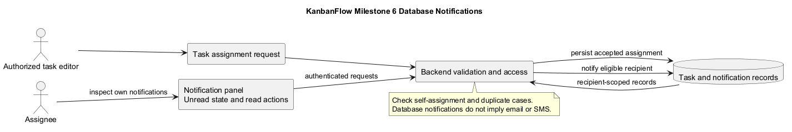
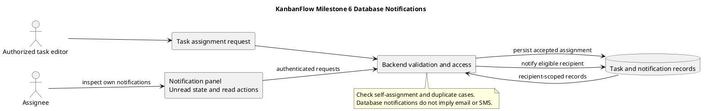

# Milestone 6 — Notifications

> **Policy amendment (2026-10-10):** Membership mutations are now owner-only; DEC-003/PB-001's bypass is fixed. Earlier open-policy text and diagrams below describe the preceding state. See [QA corrections](../../SDLC/06-testing/qa-corrections-2026-10-10.md) for the selected rule and regression evidence.

## Historical status and source identity

**Recorded status: Completed.** The original record states completion after PR #31 merged. Local Git history confirms b02b0b5 as the notifications-frontend merge commit.

- [Completion commit](https://github.com/Farhad-Valizadegan/Web-KanbanFlow/commit/b02b0b5)
- [Milestone index](../milestones.md)

This is a historical delivery record. No completion date, named reviewer, measured coverage percentage, or fresh test result is reconstructed here.

## Purpose

Milestone 6 added persistent in-app notifications for task assignments and reassignments. The intended outcome is that a recipient can discover relevant assignment updates and manage unread state inside KanbanFlow.

Notifications support awareness; they do not establish a guaranteed immediate-delivery service or a measured productivity improvement.

## Historical scope and objectives

| Area | Recorded objective |
| --- | --- |
| Assignment | Notify users when a task is assigned to them. |
| Reassignment | Notify the new assignee when an existing task is reassigned. |
| Unnecessary events | Prevent duplicate and unnecessary notifications. |
| Persistence | Store notifications in the database. |
| Access | Provide authenticated notification endpoints. |
| Interface | Add a notification panel with unread-state management. |
| Regression | Preserve task activity and authorization behavior. |

The original record's complete-test-coverage objective did not include a coverage report or exact check results. It is not treated as proof of measured full coverage.

## Pull requests

| PR | Historical description | Reference |
| --- | --- | --- |
| #30 | Notifications backend | [PR #30](https://github.com/Farhad-Valizadegan/Web-KanbanFlow/pull/30) |
| #31 | Notifications frontend | [PR #31](https://github.com/Farhad-Valizadegan/Web-KanbanFlow/pull/31) |

Descriptions come from the original document. Source integration does not imply production deployment or a complete browser verification record.

## Notification interaction

1. A permitted user creates or changes a task assignment.
2. The backend validates and authorizes the task operation.
3. Accepted changes persist task state and eligible notification records.
4. A signed-in recipient requests their notifications and unread count.
5. The panel presents those records and supports permitted state actions.
6. Subsequent requests reflect accepted read/deletion changes.

Current documentation includes listing, unread filtering/counts, marking one or all read, and deleting notifications. Inspect historical source at the completion commit for the exact milestone-time implementation; main may contain later changes.

## Recipient and access boundaries

Notifications must be scoped to the authenticated recipient. A user must not read or mutate another user's notification through a direct request.

Self-assignment, unchanged assignment, reassignment, and unassignment need distinct checks so notification behavior matches accepted work changes rather than generating unnecessary events. Task visibility and current access remain important when opening referenced resources.

Frontend controls are not authorization. Backend request checks and persisted records determine accepted state.

## Implementation and test references

- [API routes](../../../backend/routes/api.php)
- [Notification tests](../../../backend/tests/Feature/NotificationApiTest.php)
- [Task tests](../../../backend/tests/Feature/TaskApiTest.php)
- [Activity tests](../../../backend/tests/Feature/ActivityLogApiTest.php)

These are navigation links to current source. They do not assert unchanged historical test contents or a freshly executed pass result.

## Acceptance and verification criteria

| Concern | Relevant evidence |
| --- | --- |
| Assignment awareness | Eligible assignment creates the expected recipient notification. |
| Reassignment | The accepted assignee change produces the intended notification behavior. |
| Duplicate/self cases | Unchanged or unnecessary operations do not generate unwanted records. |
| Recipient isolation | Cross-user list/read/delete requests do not expose or alter another recipient's records. |
| Unread state | Count/filter and read actions agree with persisted state. |
| Persistence | Accepted actions remain correct after refresh. |
| Error handling | Invalid, denied, or failed actions show understandable feedback. |
| Regression | Task authorization and activity behavior remain valid. |

These are verification targets, not newly executed milestone results. The original document provides no exact historical test count or environment. Record fresh checks with the [verification template](../../Releases/verification-template.md).

## Scope exclusions and operational limits

This milestone concerns database notifications. It does not promise email, SMS, push services, external messaging, or guaranteed real-time synchronization.

Database/service availability and session configuration affect retrieval and state changes. Browser refresh or polling behavior should be verified against the actual implementation rather than inferred from notification persistence.

## Related milestones, releases, and open risks

[Milestone 5](MILESTONE_5.md) introduced comments and activity. [Milestone 7](MILESTONE_7.md) extended analytics and assignee controls while preserving assignment notification behavior.

Consult [release records](../../Releases/README.md) for later delivery and corrections. The manager remove/re-add membership loophole remains a separate unresolved policy issue; this milestone does not close it.

Backend SQLite tests do not prove MySQL contention or browser usability. Use the [quality plan](../quality-and-risk-plan.md) for proportionate checks.

## Completion interpretation and maintenance

Historical completion identifies the recorded feature integration. It does not establish a service-level guarantee, production deployment, recovery capability, or defect-free future behavior.

Preserve the original completion identity and link later changes to their actual commits/releases. Keep diagram source and preview synchronized and avoid backdating later validation.

## PlantUML diagram

[Editable source](diagrams/MILESTONE_6.puml)

