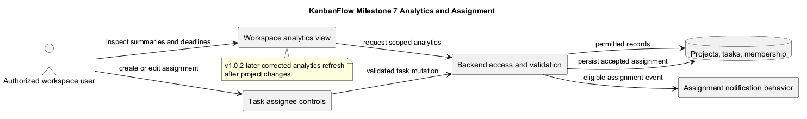
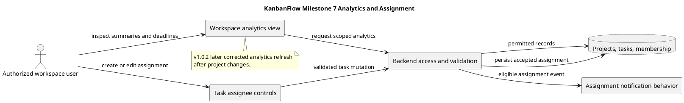

# Milestone 7 — Workspace Analytics and Task Assignment

> **Policy amendment (2026-10-10):** Membership mutations are now owner-only; DEC-003/PB-001's bypass is fixed. Earlier open-policy text and diagrams below describe the preceding state. See [QA corrections](../../SDLC/06-testing/qa-corrections-2026-10-10.md) for the selected rule and regression evidence.

## Historical status and source identity

**Recorded status: Completed.** The original milestone record states completion after PR #35 merged. Local Git history confirms 1e85e85 as the task-assignee frontend merge commit.

- [Completion commit](https://github.com/Farhad-Valizadegan/Web-KanbanFlow/commit/1e85e85)
- [Milestone index](../milestones.md)

No completion date, named reviewer, measured coverage report, or fresh check result is reconstructed here. Historical completion identifies source integration, not production deployment or the absence of later defects.

## Purpose

Milestone 7 added workspace-level progress summaries, deadline visibility, personal task tracking, and frontend assignee controls. The intended outcome is that permitted users can inspect work distribution and update task ownership in the application.

Analytics make recorded information visible; they do not guarantee forecasting accuracy, productivity improvements, or real-time reporting.

## Historical scope and objectives

| Area | Recorded outcome |
| --- | --- |
| Workspace summaries | Summary statistics for permitted workspace work. |
| Project distribution | Project counts by status. |
| Task distribution | Task counts by status and priority. |
| Deadline views | Overdue, due-today, and upcoming tasks. |
| Personal work | Tasks assigned to the current user. |
| Access boundaries | Workspace-scoped analytics authorization. |
| Assignment controls | Assignee selection during task creation and editing. |
| Regression | Preserve assignment and reassignment notification behavior. |

The original record included broad backend/frontend verification as an objective but no exact test counts or environment results. Do not infer complete measured coverage from that objective.

## Pull request sequence

| PR | Historical description | Reference |
| --- | --- | --- |
| #33 | Workspace analytics backend | [PR #33](https://github.com/Farhad-Valizadegan/Web-KanbanFlow/pull/33) |
| #34 | Workspace analytics frontend | [PR #34](https://github.com/Farhad-Valizadegan/Web-KanbanFlow/pull/34) |
| #35 | Task assignee frontend controls | [PR #35](https://github.com/Farhad-Valizadegan/Web-KanbanFlow/pull/35) |

Descriptions are retained from the original document. The completion commit anchors historical integration; current main contains later changes.

## Analytics flow

1. A signed-in user opens a permitted workspace summary.
2. The frontend requests analytics through the backend.
3. The backend applies workspace and relevant resource-access rules.
4. Permitted project/task records supply counts and task lists.
5. The frontend presents distributions, deadline views, and personal work.
6. Relevant accepted mutations must refresh affected displayed data.

Refresh behavior is a current correctness concern; v1.0.2 later corrected stale analytics after project creation, editing, and deletion. That correction must not be backdated into initial milestone delivery.

## Assignment flow

1. A permitted user selects an assignee when creating or editing a task.
2. The backend validates the task request and eligible assignment.
3. Accepted changes persist the assigned user or unassigned state.
4. Assignment/reassignment follows the existing notification behavior.
5. Task views and relevant personal-work summaries reflect accepted state.

Frontend controls are not authorization. Requests and persisted data determine whether an assignment is accepted.

## Data and access boundaries

- Workspace membership limits analytics access.
- Board visibility and nested-resource restrictions remain relevant to summaries and task lists.
- Personal-work views must represent the authenticated user's permitted work.
- Invalid or denied assignment changes must not alter accepted records.
- Deadline results depend on actual due-date values and the application's date/time interpretation.

Inspect source when evaluating exact grouping, filtering, and date behavior; this document does not invent timezone guarantees or reporting formulas.

## Implementation and check references

- [API routes](../../../backend/routes/api.php)
- [Workspace analytics tests](../../../backend/tests/Feature/WorkspaceAnalyticsApiTest.php)
- [Task tests](../../../backend/tests/Feature/TaskApiTest.php)
- [Notification tests](../../../backend/tests/Feature/NotificationApiTest.php)
- [Review regression tests](../../../backend/tests/Feature/ReviewRegressionTest.php)

These current-source links provide navigation. They do not imply unchanged historical tests or a fresh pass result for this documentation edit.

## Acceptance and verification criteria

| Concern | Relevant observation or check |
| --- | --- |
| Summary accuracy | Counts and distributions agree with permitted stored records. |
| Deadline boundaries | Relevant due-date cases appear in the intended categories. |
| Personal work | Current-user task lists reflect assignment and access rules. |
| Authorization | Denied users cannot retrieve workspace/private-resource information. |
| Assignment persistence | Accepted assignment changes remain correct after refresh. |
| Invalid assignment | Rejected requests preserve the previous stored state and show feedback. |
| Notification regression | Assignment/reassignment follows intended recipient behavior. |
| Cache refresh | Relevant project/task changes update displayed summaries. |
| Empty and failure states | Missing data and failed requests produce understandable views. |

These are criteria for fresh checks, not historical test results. Record exact commit, environment, scenarios, and outcomes with the [verification template](../../Releases/verification-template.md).

## Later corrections and known issues

[v1.0.1](../../Releases/v1.0.1.md) refined private-board visibility, including analytics-related access. [v1.0.2](../../Releases/v1.0.2.md) corrected project-change analytics invalidation and recorded browser refresh validation.

The manager remove/re-add role-change loophole remains unresolved and requires its own policy decision and enforcement. See the [decision register](../decision-register.md).

Backend SQLite evidence does not establish MySQL contention behavior; browser evidence is needed for cache refresh and assignee controls. Use the [quality plan](../quality-and-risk-plan.md).

## Relationships, exclusions, and maintenance

[Milestone 6](MILESTONE_6.md) provides the notification context preserved by assignment changes. [Milestone 8](MILESTONE_8.md) later added CI and build improvements.

This milestone does not promise forecasting, billing, time tracking, external reporting integrations, email/SMS delivery, or guaranteed real-time synchronization.

Preserve the historical completion identity, link later corrections to their actual releases, and synchronize the PlantUML source and preview when this record changes.

## PlantUML diagram

[Editable source](diagrams/MILESTONE_7.puml)

