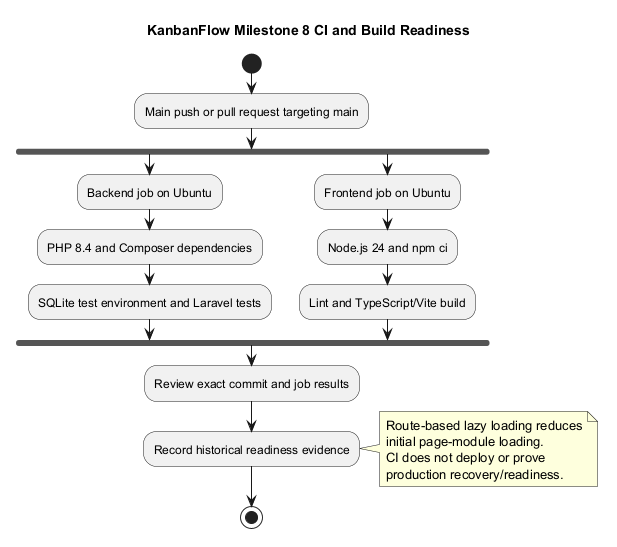
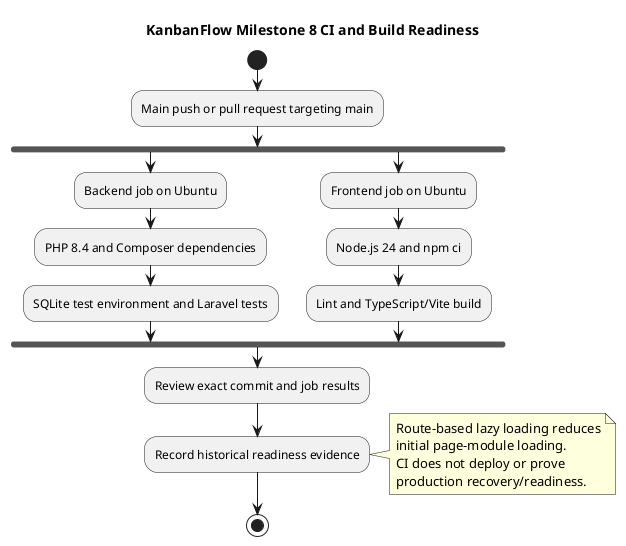

# Milestone 8 — Production Readiness and Continuous Integration

## Historical status and source identity

**Recorded status: Completed.** The original record states completion after PR #37 merged. Local Git history confirms a09155d as that merge commit.

- [PR #37 — CI and frontend code splitting](https://github.com/Farhad-Valizadegan/Web-KanbanFlow/pull/37)
- [Completion commit](https://github.com/Farhad-Valizadegan/Web-KanbanFlow/commit/a09155d)
- [Milestone index](../milestones.md)

“Production readiness” here refers to the recorded repository verification and build improvements. It does not establish a production deployment, uptime target, security certification, supported-browser matrix, or verified recovery procedure.

## Purpose and delivered scope

Milestone 8 improved automated verification, dependency-installation efficiency, and frontend loading structure. It made source changes easier to check before delivery and reduced the recorded largest JavaScript chunk through route-based splitting.

| Area | Historical outcome |
| --- | --- |
| Backend automation | Laravel test job in GitHub Actions. |
| Frontend automation | ESLint, TypeScript, and Vite build job. |
| Triggers | Main pushes and pull requests targeting main. |
| Dependency caching | Composer and npm download caches based on lockfiles. |
| Route loading | React lazy-loaded pages with Suspense fallback. |
| Build output | Separate chunks and removal of the recorded large-chunk warning. |

## Historical objectives

- Automate backend and frontend verification.
- Check pull requests and main-branch changes.
- Cache dependency downloads.
- Add route-based code splitting.
- Reduce the recorded main/largest JavaScript chunk.
- Verify local checks and GitHub Actions results.

These objectives and outcomes come from the original milestone document. No new runtime measurements or fresh application test results are claimed by this documentation update.

## CI workflow

The workflow is at [ci.yml](../../../.github/workflows/ci.yml). It contains two independent jobs.

### Backend Tests

The historical record describes Ubuntu, PHP 8.4, Composer 2, SQLite extensions, dependency cache restoration, locked dependency installation, environment/key setup, and php artisan test.

The test configuration uses [in-memory SQLite](../../../backend/phpunit.xml). Passing it does not establish MySQL lock contention, production database behavior, or browser correctness.

### Frontend Build and Lint

The historical record describes Ubuntu, Node.js 24, npm cache restoration, npm ci, ESLint, and the TypeScript/Vite production build.

A successful build establishes compilation/package output for that environment, not accessibility, browser journeys, deployment, or recovery correctness.

### Automation boundary

Current CI still runs on main pushes and pull requests targeting main. It does not automatically publish release tags, create GitHub releases, deploy services, or restore backups.

Inspect current workflow source for current details; the historical description is not a guarantee that tooling never changes.

## Dependency caching

Composer and npm caches reduce repeated download work. The recorded cache keys use backend/composer.lock and frontend/package-lock.json.

Lockfile-based installation supports reproducibility, while caches are installation aids rather than verification evidence. A cache hit does not prove dependencies or application behavior are correct.

## Route-based frontend loading

The historical record identifies Home, Login, Register, Dashboard, Workspace, Project, and Board pages as dynamically loaded routes. React Suspense provides loading feedback while modules load.

See [App.tsx](../../../frontend/src/App.tsx) for current routing. Later interface changes may alter chunk sizes and loading behavior; inspect the actual build when assessing a new commit.

## Recorded bundle comparison

| Historical measurement | Size | Gzip |
| --- | --- | --- |
| Main JavaScript bundle before splitting | 556.69 kB | 159.69 kB |
| Largest JavaScript bundle after splitting | 314.40 kB | 101.94 kB |

The original record reports separate page/feature chunks and no longer seeing the prior warning for JavaScript chunks larger than 500 kB.

These measurements describe historical artifacts with different chunk structure. They do not measure total application transfer, user-perceived load time, or present-day build sizes. No performance percentage or service guarantee is inferred.

## Historical validation

| Check | Original recorded result |
| --- | --- |
| Backend suite | 153 tests and 429 assertions passed. |
| Frontend lint | Passed. |
| TypeScript/Vite build | Passed; 242 modules transformed. |
| Git diff check | Passed. |
| GitHub Actions Backend Tests | Passed. |
| GitHub Actions Frontend Build and Lint | Passed. |

These are preserved historical claims. The original document does not provide a specific CI run URL or dated environment artifact here; none is invented. Later releases have different test counts and source behavior.

## Criteria for fresh assessment

When changing CI or loading behavior, verify:

- Workflow triggers, runtime setup, locked dependency installation, and job results.
- Relevant local checks against the exact changed commit.
- Route loading and failure/loading feedback in the browser when affected.
- Actual build chunks and warnings, without comparing unlike totals blindly.
- No unintended deployment/publication permissions or secret exposure.
- Explicit limits for browser, MySQL contention, deployment, and recovery evidence.

Use the [quality plan](../quality-and-risk-plan.md) and [verification template](../../Releases/verification-template.md).

## Release and operational boundaries

Milestone completion and CI success do not automatically publish a version. Follow the [release pipeline](../release-pipeline.md) for separately authorized tags and notes.

Before production claims, establish the target environment, configuration, service checks, data compatibility, backup/restore evidence, and agreed operational targets. Consult [upgrade and rollback guidance](../../Releases/upgrade-and-rollback.md). Code rollback does not restore data.

## Known issue and later history

The manager remove/re-add role-change loophole remains unresolved; CI existence does not prove the missing policy is enforced. See the [decision register](../decision-register.md).

[Release records](../../Releases/README.md) describe later security, session, analytics, and interface changes. Preserve those changes at their actual version rather than backdating them into this milestone.

## Maintenance

Preserve historical source identity and measurements, qualify unsupported claims, and add later evidence with its exact commit/environment. Synchronize PlantUML source and preview when this record changes.

## PlantUML diagram

[Editable source](diagrams/MILESTONE_8.puml)

