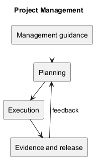
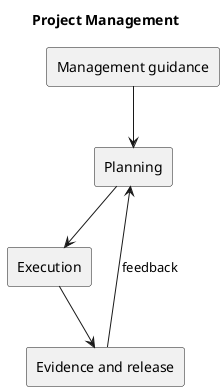

# Project Management

This section provides working management guidance for KanbanFlow. Processes and future priorities are proposals unless identified as repository evidence. No sprint dates, staffing commitments, or delivery estimates are implied.

## Documents

- [Backlog Refinement](backlog-refinement.md)
- [Decision Register](decision-register.md)
- [Documentation Traceability](documentation-traceability.md)
- [Milestones](milestones.md)
- [Product Backlog](product-backlog.md)
- [Quality and Risk Plan](quality-and-risk-plan.md)
- [Release Pipeline](release-pipeline.md)
- [Roadmap](roadmap.md)
- [Sprint Workflow](sprint-workflow.md)
- [Traceability](traceability.md)
- [Versioning Strategy](versioning-strategy.md)

## Maintenance

Use the changelog for released history, Git commits for delivered changes, and CI results for automated evidence. Update documents when decisions or scope change. Each diagram has a PNG preview, inline PlantUML, and a matching standalone source. Regenerate previews after source changes.

## Related evidence

- [Project definition](../Project-Definition/README.md)
- [Release history](../../CHANGELOG.md)
- [CI configuration](../../.github/workflows/ci.yml)

## PlantUML diagram

[Editable source](diagrams/README.puml)

