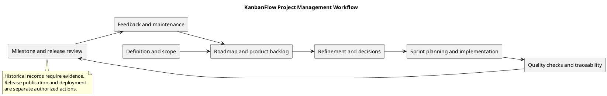

# KanbanFlow Project Management

## Purpose and status

This section connects product scope, planning, decisions, implementation, verification, milestones, and release preparation. It provides working guidance for managing KanbanFlow changes without turning proposals into claims of completed delivery.

No named staffing plan, sprint schedule, capacity estimate, delivery date, or numerical service commitment is established by this index. Actual assignments and approvals must be recorded when agreed.

## Documentation directory

| Document | Purpose | Use when |
| --- | --- | --- |
| [Roadmap](roadmap.md) | Delivered baseline and proposed future direction. | Reviewing priorities and dependencies. |
| [Product backlog](product-backlog.md) | Candidate improvements with acceptance targets. | Selecting work for refinement. |
| [Backlog refinement](backlog-refinement.md) | Clarify outcome, scope, policy, and verification. | Preparing an item for planning. |
| [Decision register](decision-register.md) | Implemented decisions and unresolved policy questions. | Comparing options or changing a binding rule. |
| [Sprint workflow](sprint-workflow.md) | Proposed execution and review process. | Coordinating a scoped delivery goal. |
| [Quality and risk plan](quality-and-risk-plan.md) | Risk-based verification strategy. | Choosing checks and evaluating gaps. |
| [Traceability](traceability.md) | Link requirements, decisions, changes, and checks. | Demonstrating a feature's outcome. |
| [Documentation traceability](documentation-traceability.md) | Map descriptions to source evidence. | Updating documents after behavior changes. |
| [Milestones](milestones.md) | Index historical stages and proposed next milestones. | Reviewing historical delivery evidence. |
| [Release pipeline](release-pipeline.md) | Manual release sequence and current automation limits. | Preparing an authorized release. |
| [Versioning strategy](versioning-strategy.md) | Version selection and metadata consistency. | Assessing compatibility and selecting a version. |

## Folder organization

Historical milestone documents are grouped in [Milestones](Milestones/). Their dates, statuses, and validation remain historical rather than evidence of a fresh check.

Editable PlantUML files and PNG previews are in [diagrams](diagrams/). Every management document includes an inline diagram source and preview; update both copies and regenerate images after source changes.

Detailed sprint and release kits live in their own sections rather than being duplicated here:

- [Sprint guides and templates](../Sprints/README.md)
- [Release records and operations](../Releases/README.md)
- [SDLC phase guides](../SDLC/README.md)
- [Project definitions](../Project-Definition/README.md)

## Recommended workflow

1. Confirm the user problem, scope boundary, and affected stakeholders.
2. Add or refine a backlog item with observable acceptance criteria.
3. Resolve dependencies and policy questions in the decision register.
4. Agree the work goal, scope, and actual owners when needed.
5. Implement small changes and preserve unrelated work.
6. Run checks appropriate to the affected risk and record exact evidence.
7. Update implementation and documentation traceability.
8. Review completed behavior, open issues, and any release implications.
9. Publish or deploy only within the authorized scope; verify remote results.
10. Use feedback to reprioritize the backlog.

This is a working process, not proof that every historical change followed every step.

## Responsibilities and decisions

| Responsibility | Expected contribution |
| --- | --- |
| Scope and priority decision-maker | Agree the intended outcome, exclusions, and priority. |
| Maintainer | Implement, review, verify, and document scoped changes. |
| Workspace owner | Clarify intended membership administration rules. |
| Operator | Assess configuration, deployment, backup, and recovery needs. |
| Reviewer or participating user | Evaluate the relevant acceptance criteria and observed behavior. |

These are responsibilities rather than named appointments or a formal organizational hierarchy. A person may perform multiple responsibilities when appropriate; no approval is inferred from a template.

## Evidence and source of truth

| Claim | Evidence to consult |
| --- | --- |
| Implemented behavior | Source code, relevant tests, and runtime observations. |
| Published version | Immutable tag and published release notes. |
| Released change history | [Changelog](../../CHANGELOG.md) and release records. |
| Current automation | [CI workflow](../../.github/workflows/ci.yml). |
| Fresh verification | Exact commit, environment, commands/scenarios, and results. |
| Proposed work | Backlog or roadmap entry clearly marked proposed. |
| Agreed policy | Explicit decision record and corresponding enforcement evidence. |

Git history shows source delivery, not customer validation or production deployment. Historical test counts cannot substitute for fresh verification of changed behavior.

## Known issue and planning boundary

The manager remove/re-add path can bypass intended owner-only role changes. Resolve the allowed manager operations before implementing or claiming full enforcement. Keep the decision and backlog entry open until direct and indirect paths are regression-verified.

No new release version, completed sprint, or operational guarantee is created by adding management documentation. Proposed user guidance and recovery work are candidates, not dated commitments.

## Completion and release readiness

Use the [definition of ready](../Sprints/definition-of-ready.md) to assess work selection and the [definition of done](../Sprints/definition-of-done.md) for completion evidence. Keep blockers and skipped checks visible.

Current CI covers backend tests and frontend lint/build on main pushes and pull requests into main. Browser usability, MySQL contention, deployment, and recovery require separate evidence when relevant. Consult the [release checklist](../Releases/release-checklist.md) before publication.

## Maintenance rules

- Update affected documents alongside scope, policy, or implementation changes.
- Preserve historical release and milestone records as historical evidence.
- Keep links, PlantUML copies, and previews synchronized.
- Avoid invented owners, dates, estimates, user research, or metrics.
- Keep credentials and personal account details out of records and diagrams.
- Record unresolved questions with a concrete next decision or verification step.

## PlantUML diagram

[Editable source](diagrams/README.puml)

