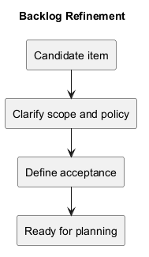
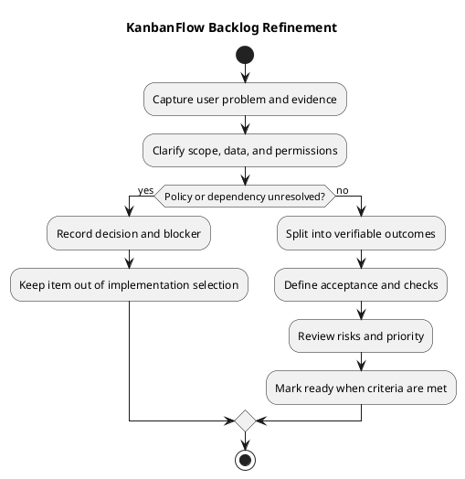

# KanbanFlow Backlog Refinement

> **Policy amendment (2026-10-10):** Membership mutations are now owner-only; DEC-003/PB-001's bypass is fixed. Current guidance below reflects this rule; historical records retain their original scope. See [QA corrections](../SDLC/06-testing/qa-corrections-2026-10-10.md) for the selected rule and regression evidence.

## Purpose

Refinement turns a candidate improvement or defect into work with a clear user outcome, scope, dependencies, and verification criteria. It reduces uncertainty before implementation without inventing estimates, approval, or delivery commitments.

This is a working process. No mandatory meeting cadence, named product owner, capacity baseline, or scheduling authority is established here. Actual decisions and assignments must be recorded when agreed.

## Inputs

- User feedback, reproducible defects, or a proposed capability.
- The [product backlog](product-backlog.md) and [roadmap](roadmap.md).
- Current source behavior, relevant tests, and published release evidence.
- [Product scope](../Project-Definition/scope-and-stakeholders.md), constraints, and known risks.
- Open policy questions in the [decision register](decision-register.md).

A suggestion is a candidate, not proof that the problem is validated or the change approved.

## Item record

| Field | What to capture |
| --- | --- |
| Identifier and title | Stable reference and concrete outcome. |
| Problem and evidence | User need or reproducible failing behavior; distinguish hypotheses from observations. |
| Affected users | Roles and permitted journeys affected. |
| Current and desired behavior | Before/after behavior without prescribing unnecessary implementation detail. |
| Scope and exclusions | Resources, interfaces, and changes included or excluded. |
| Acceptance criteria | Observable results, including relevant failures and denied actions. |
| Dependencies and decisions | Missing policy, environment, interface, or prerequisite work. |
| Risks and checks | Data, permission, concurrency, usability, and compatibility boundaries. |
| State and next action | Proposed, needs clarification, blocked, or ready with an explicit next step. |
| Owner and estimate | Actual agreed values, or unassigned/not estimated. |

## Refinement steps

### 1. Establish the problem

For a defect, record the trigger, expected result, actual result, and authorized reproduction environment. For a feature, state who needs the outcome and what evidence supports it. Do not treat a preferred implementation as the user problem.

### 2. Confirm scope

Identify affected workspace, project, board, task, or membership behavior. Check whether the change fits the current scope or requires an explicit scope decision. State exclusions so adjacent improvements do not silently enlarge the item.

### 3. Inspect dependencies and policy

Trace relevant source, API, data, and tests. Resolve ambiguous role rules before implementing enforcement. Record operational dependencies such as consistent session origins or an isolated database for contention checks.

### 4. Split into coherent outcomes

Prefer changes that can be reviewed and verified independently. Preserve dependencies between policy, backend enforcement, interface feedback, and documentation. Avoid splitting an item into pieces that leave the accepted user outcome incomplete.

### 5. Define acceptance criteria

Describe observable behavior for normal actions and the relevant invalid, denied, stale, or failed requests. Include persistence after refresh, ordering/WIP integrity, keyboard behavior, and rollback when affected.

### 6. Select verification

Choose the smallest checks that demonstrate the criteria, then broaden according to risk. Backend SQLite tests do not prove MySQL contention. Frontend lint/build do not prove user journeys or accessibility. Record any required check that cannot yet run.

### 7. Review priority and readiness

Consider user impact, security, integrity, dependencies, and uncertainty. Record the agreed priority without presenting it as a statistical risk score. Mark the item ready only when readiness criteria are met; scheduling remains a separate decision.

## Ready, blocked, and deferred states

| State | Meaning | Next action |
| --- | --- | --- |
| Needs clarification | Outcome or scope is ambiguous. | Obtain the missing requirement or evidence. |
| Blocked | A required policy, prerequisite, or environment is missing. | Record the blocker and decision/action needed. |
| Ready | Scope, acceptance, dependencies, and verification are understood. | Consider selection against an agreed goal and capacity. |
| Deferred | The item is intentionally not selected now. | Record the reason and revisit trigger. |

Readiness is not completion, release authorization, or a promised delivery date. Use the [definition of ready](../Sprints/definition-of-ready.md) and [definition of done](../Sprints/definition-of-done.md) consistently.

## KanbanFlow example: manager membership loophole

The original problem was that managers could remove and re-add members with another role to bypass owner-only direct role changes. It is recorded as PB-001 and DEC-003 in the existing backlog and decision register.

### Recorded membership decision

DEC-003 selected owner-only additions, removals, and role updates on 2026-10-10. Managers retain project/board management; any future membership delegation requires an explicit safe policy.

### Regression criteria for the selected policy

- Only owners can update roles or add/remove members; managers are denied.
- Removal and re-addition cannot bypass those same rules.
- Requests are checked in the backend even when sent without frontend controls.
- Current membership, denied users, and applicable owner protections are covered.
- Rejected operations leave persisted membership unchanged and produce clear feedback.

The 2026-10-10 QA correction records implementation and regression evidence for PB-001. Recheck these criteria when membership authority changes; historical results do not verify a new candidate.

## Priority and estimation boundaries

Use observed impact and dependencies to prioritize. Estimate only when the team chooses a method and records actual estimates. No story points, velocity, dates, or staffing are inferred from repository history.

Security and data-integrity issues deserve explicit review, but this document does not silently approve new scope or impose a release decision.

## Outputs and traceability

A refined item has a clear outcome, acceptance criteria, dependencies, state, and planned evidence. Link decisions and later implementation/check records through [traceability](traceability.md).

Update affected documentation when behavior changes, using [documentation traceability](documentation-traceability.md). Record new follow-up items rather than hiding unfinished criteria.

## Review checklist

- Is the problem supported by evidence or clearly marked hypothetical?
- Are affected roles, scope, and exclusions explicit?
- Are policy and data dependencies resolved or visibly blocked?
- Can acceptance criteria be demonstrated in an authorized environment?
- Are failure and permission boundaries covered where relevant?
- Are priority, owner, estimate, and scheduling claims actually agreed?
- Does the item support a coherent user outcome?

## PlantUML diagram

[Editable source](diagrams/backlog-refinement.puml)

