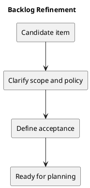

# Backlog Refinement

## Proposed process

1. Describe the user problem and expected outcome.
2. Check scope, affected permissions, data, and dependencies.
3. Split work into independently verifiable changes.
4. Define acceptance criteria and appropriate checks.
5. Prioritize with the product owner before scheduling.

## Ready criteria

An item should have a clear outcome, explicit scope, acceptance criteria, dependencies, and unresolved questions. Estimates and owners are assigned only when agreed.

Use the membership loophole as a refinement example: decide which roles managers may add/remove before implementing enforcement.

## Related evidence

- [Project definition](../Project-Definition/README.md)
- [Release history](../../CHANGELOG.md)
- [CI configuration](../../.github/workflows/ci.yml)

## PlantUML diagram

[Editable source](diagrams/backlog-refinement.puml)

