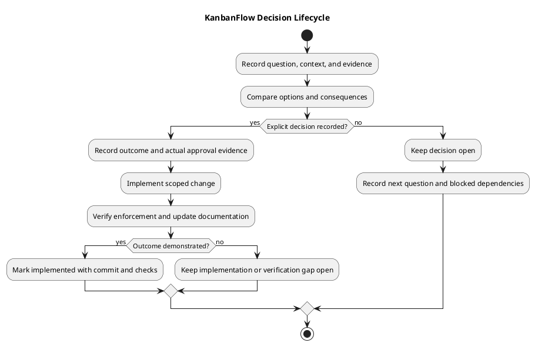

# KanbanFlow Decision Register

## Purpose and evidence rules

This register records material product and implementation choices and keeps unresolved questions visible. It distinguishes observed implementation from an explicit approval record.

The entries below are grounded in repository behavior and release documentation. They do not invent approvers, decision dates, rejected alternatives, or discussion history. Publication dates identify releases, not necessarily the date a decision was made.

## Decision index

| ID | Subject | State | Evidence |
| --- | --- | --- | --- |
| DEC-001 | Product name KanbanFlow; repository/folder name Web-KanbanFlow | Implemented | [Project README](../../README.md) and [v1.0.2 record](../Releases/v1.0.2.md). |
| DEC-002 | Light, Dark, and System themes with browser-local preference | Implemented | [v1.1.0 record](../Releases/v1.1.0.md) and [frontend theme implementation](../../frontend/src/components/theme/). |
| DEC-003 | Manager membership operations and indirect role changes | Open | [Known issue history](../../CHANGELOG.md) and [PB-001](product-backlog.md). |

IDs are stable references. Add new decisions when there is a material question or outcome to record; do not turn every ordinary implementation detail into a policy record.

## DEC-001 — Naming

### Context and outcome

The product is named KanbanFlow. The GitHub repository and current local project folder use Web-KanbanFlow. Product-facing titles and documentation should use the product name; repository/setup paths use the repository name.

### Evidence and consequences

The [README](../../README.md) and frontend package metadata reflect the product name. The [v1.0.2 release record](../Releases/v1.0.2.md) records naming changes. The local folder rename was pending at that historical release and is now complete.

Renaming requires updating setup links and references without rewriting historical release claims. No separate approver/date record or rejected-option analysis is reconstructed here.

### State

Implemented. Review new user-facing strings and setup references for naming consistency when changed.

## DEC-002 — Themes and preference storage

### Context and outcome

The application supports Light, Dark, and System appearance. System follows the browser's system appearance signal. The selected preference is stored in the browser and synchronized between tabs through the implemented theme behavior.

### Evidence and consequences

The [v1.1.0 release](../Releases/v1.1.0.md) records themes and historical browser validation. [Theme source](../../frontend/src/components/theme/) is the implementation evidence.

Browser-local storage does not provide shared account preferences across devices. Theme changes affect contrast, focus, and readability throughout the interface, so affected views require browser checks.

### State

Implemented. New view styling should remain compatible with all supported theme modes. Historical checks are not fresh validation for later UI changes.

## DEC-003 — Manager membership policy

### Problem

Managers can bypass intended owner-only role changes by removing and re-adding a member with a different role. Direct role restrictions alone do not close the indirect path.

### Questions requiring agreement

- Which members may managers add or remove?
- Which roles may managers assign when adding members?
- How should removal/re-addition preserve owner-only restrictions?
- What owner and current-membership protections must be enforced?

### Options for consideration

| Option | Expected direction | Consequences to evaluate |
| --- | --- | --- |
| Owners manage membership exclusively | Reserve add/remove and role assignment to owners. | Simpler administration boundary; reduces manager autonomy. |
| Managers have constrained membership operations | Define an explicit permitted subset, potentially limited to viewer membership. | More delegation; requires precise direct and indirect enforcement. |

These are candidate directions, not approved policy. The exact permitted operations must be explicitly agreed rather than inferred from role names.

### Required closure evidence

Record the selected rule and its actual authorization evidence. Enforce it in backend membership paths and verify direct role updates, removal, re-addition, denied users, current membership, and relevant owner protections. Update frontend feedback and documentation as affected.

Use [backlog refinement](backlog-refinement.md) and [PB-001](product-backlog.md) to scope the implementation. Until closure, owners should manage membership.

### State

Open. No chosen option, approver, deadline, or completed fix is recorded.

## Decision states

| State | Meaning |
| --- | --- |
| Open | Question unresolved; options may be under review. |
| Decided | An explicit outcome is recorded, with actual authorization evidence where applicable. |
| Implementing | The decided change is in progress. |
| Implemented | Source and relevant verification demonstrate the outcome. |
| Superseded | A later identified decision replaces the outcome. |
| Withdrawn | The proposal is intentionally abandoned with a recorded reason. |

For historical implemented behavior without a separate approval record, state that limitation. Do not fabricate a transition history.

## New decision template

| Field | Required content |
| --- | --- |
| ID and title | Stable reference and specific question. |
| Context | User problem, current behavior, and constraints. |
| Options | Viable alternatives and relevant consequences. |
| Outcome | Actual chosen rule, or explicitly unresolved. |
| Rationale | Recorded reasons, not reconstructed assumptions. |
| Authorization and date | Actual approver/evidence and date when available; otherwise not recorded. |
| Dependencies | Blocked backlog items, operational requirements, or prerequisite changes. |
| Implementation | Exact commit or pull request when delivered. |
| Verification | Scenarios/results and known gaps tied to an exact environment and commit. |
| Follow-up | Review trigger or superseding decision reference. |

## Review and change process

1. Identify the material question and affected stakeholders.
2. Collect implementation evidence and relevant constraints.
3. Compare options, including permission, data, compatibility, and operational effects.
4. Record the explicit outcome and unresolved details.
5. Link affected backlog items and scoped implementation.
6. Verify the delivered behavior before marking implementation complete.
7. Update related documentation and retain superseded history.

A decision record does not automatically authorize publication, deployment, or unrelated work. Preserve the user's explicit scope and actual approval evidence.

## Traceability and maintenance

Link decisions through [feature traceability](traceability.md) and [documentation traceability](documentation-traceability.md). Use the [verification template](../Releases/verification-template.md) for check evidence.

Review the register when policy, architecture, compatibility, or scope changes. Keep implemented outcomes separate from roadmap proposals, historical release checks, and open risks. Synchronize the PlantUML source and rendered preview.

## PlantUML diagram

[Editable source](diagrams/decision-register.puml)

