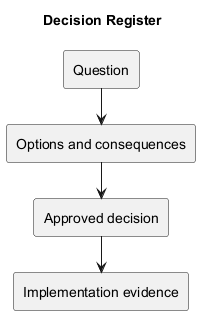
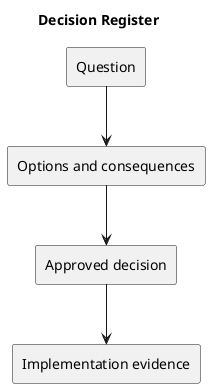

# Decision Register

## Recorded evidence and open decisions

| ID | Decision or question | State | Evidence |
| --- | --- | --- | --- |
| DEC-001 | Product name is KanbanFlow; repository is Web-KanbanFlow | Implemented | Project README and repository naming. |
| DEC-002 | Light, Dark, and System themes with browser preference | Implemented | v1.1.0 changelog. |
| DEC-003 | Which roles may managers add/remove without bypassing owner role changes? | Open | Known issue in changelog. |

## Decision format

Record context, options, chosen outcome, rationale, consequences, approver, and date when available. Do not invent approvals or dates. Link the implementation and verification when the decision is delivered.

## Related evidence

- [Project definition](../Project-Definition/README.md)
- [Release history](../../CHANGELOG.md)
- [CI configuration](../../.github/workflows/ci.yml)

## PlantUML diagram

[Editable source](diagrams/decision-register.puml)

