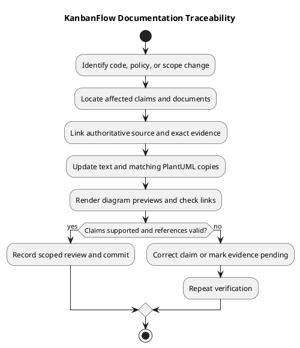

# KanbanFlow Documentation Traceability

> **Policy amendment (2026-10-10):** Membership mutations are now owner-only; DEC-003/PB-001's bypass is fixed. Current guidance below reflects this rule; historical records retain their original scope. See [QA corrections](../SDLC/06-testing/qa-corrections-2026-10-10.md) for the selected rule and regression evidence.

## Purpose and distinction

Documentation traceability connects a statement in a document to the source, decision, or verification that supports it. It helps identify which documents need revision when behavior or scope changes.

[Feature traceability](traceability.md) connects requirements, backlog items, implementation, and tests. This guide focuses on the accuracy and maintenance of the descriptions of that work. Neither a link nor a passing build proves a statement is correct without reviewing its supporting evidence.

## Documentation-to-evidence map

| Topic | Documentation | Evidence and boundary |
| --- | --- | --- |
| Product purpose and goals | [Overview](../Project-Definition/overview-and-goals.md), [problem statement](../Project-Definition/project-problem-statement.md) | Working hypotheses and observable targets; do not infer user research or productivity gains. |
| Scope and stakeholders | [Scope](../Project-Definition/scope-and-stakeholders.md), [boundary](../Project-Definition/scope-boundary-diagram.md) | Implemented capabilities plus explicitly excluded/proposed scope. |
| Runtime constraints | [Assumptions](../Project-Definition/assumptions-and-constraints.md) | Manifests, lockfiles, configuration, and intended environment evidence. |
| System interactions | [Context](../Project-Definition/project-context-diagram.md), [external systems](../Project-Definition/stakeholders-and-external-systems.md) | Backend routes, frontend flows, persistence, and CI configuration. |
| Membership policy | [Decision register](decision-register.md), [backlog](product-backlog.md) | Owner-only policy selected and enforced; see DEC-003 and the dated QA regression evidence. |
| Management guidance | [Management index](README.md) and related guides | Actual decisions versus working process proposals. |
| Historical milestones | [Milestone index](milestones.md), [Milestones folder](Milestones/) | Historical stage documents; not fresh verification. |
| Sprint process and templates | [Sprint index](../Sprints/README.md) | Templates, with actual sprint records only when agreed and recorded. |
| Lifecycle guidance | [SDLC index](../SDLC/README.md) | Working phase guidance rather than proof of production completion. |
| Released changes | [Changelog](../../CHANGELOG.md), [release index](../Releases/README.md) | Published tags, release notes, and dated validation evidence. |
| Automated checks | [CI workflow](../../.github/workflows/ci.yml), [PHPUnit configuration](../../backend/phpunit.xml) | Configured check coverage; SQLite tests do not establish MySQL contention. |

## Authoritative source references

- [Project README](../../README.md): product/setup entry point.
- [Backend API routes](../../backend/routes/api.php): declared protected resource endpoints.
- [Composer manifest](../../backend/composer.json): backend dependency ranges.
- [Frontend package manifest](../../frontend/package.json): dependency ranges and lint/build commands.
- [Sanctum configuration](../../backend/config/sanctum.php): stateful session boundary.
- [CI workflow](../../.github/workflows/ci.yml): current automated triggers and jobs.

Use implementation and relevant tests for detailed behavior; a manifest does not establish runtime success. Use exact commit/tag links when recording historical evidence rather than mutable main references alone.

## Claim categories

| Category | How to describe it |
| --- | --- |
| Current implementation | Identify relevant source and verify the actual behavior as needed. |
| Historical result | Name the release/commit, environment, and recorded result; do not call it fresh. |
| Proposed goal or process | Clearly mark it proposed or working guidance. |
| Open decision or defect | State the unresolved question and next evidence/action needed. |
| Operational commitment | Record actual agreed targets and demonstrated environment evidence. |

Do not invent approvals, owners, sprint dates, customer findings, metrics, or deployment results to fill a document.

## Change-impact workflow

1. Identify the changed behavior, policy, interface, runtime requirement, or scope.
2. Search for affected names, paths, concepts, version references, and diagram labels.
3. Compare each affected claim with authoritative evidence.
4. Update explanations and links, preserving historical context.
5. Update inline PlantUML and its standalone source together.
6. Regenerate previews and check diagram syntax and readability.
7. Verify relative paths and review the scoped diff.
8. Record the supporting commit/check evidence where relevant.

If evidence is missing, qualify the claim or leave it pending. Do not silently turn an unverified assumption into a fact.

## Diagram and link maintenance

Each diagram document uses an inline PlantUML block, a matching .puml file, and a rendered PNG preview. The source copies must match; the preview must be regenerated after source changes. Rendering success checks syntax, while visual inspection checks readability.

Relative links should resolve from the document's folder. When moving a document, review both inbound links and its own relative references. Folder moves also affect README trees and navigation indexes.

Do not use third-party diagram renderers with confidential source or personal data without appropriate authorization. Current committed previews can be generated locally.

## Traceability record template

| Field | Content to record |
| --- | --- |
| Document and claim | File/section and the statement affected. |
| Trigger | Source change, policy decision, move, release, or observed mismatch. |
| Evidence | Exact source, decision, commit/tag, or check result. |
| Required update | Text, path, source diagram, preview, or historical qualification. |
| Verification | Link/source checks, rendering, review, and applicable runtime evidence. |
| State | Updated, pending evidence, or blocked with reason. |
| Follow-up | Actual assigned action/owner when agreed. |

This is a record format, not an automatically maintained database or a claim that every existing document has a separate review entry.

## KanbanFlow examples

### Milestone reorganization

Historical files were moved into Project-Management/Milestones. Root and documentation links and the README tree were updated. The move changes navigation, not the historical completion or test claims in the files.

### Membership loophole

Current scope, risk, decision, backlog, and release guidance must reflect the owner-only correction in DEC-003/PB-001. Historical records preserve the earlier issue and link to the dated QA correction.

### Published versus untagged changes

A later main commit may improve styling or documentation without creating a new published version. Keep [unreleased changes](../Releases/unreleased.md), package versions, and release history distinct; snapshot lists need maintenance and are not live feeds.

## Verification boundaries

Link checks demonstrate reference existence, not semantic accuracy. Diagram-source equality does not prove architectural correctness. Automated backend/frontend checks do not demonstrate browser usability, MySQL contention, deployment, or backup recovery.

Use the [release verification template](../Releases/verification-template.md) for fresh evidence and keep known gaps explicit.

## Review and maintenance

Review affected documents during implementation and release preparation. Revisit this map when categories, file locations, integration boundaries, or evidence practices change. Preserve historical facts and identify corrections clearly rather than silently rewriting released claims.

## PlantUML diagram

[Editable source](diagrams/documentation-traceability.puml)

