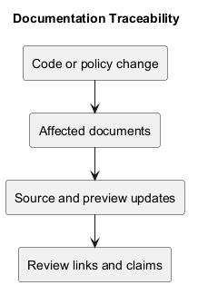
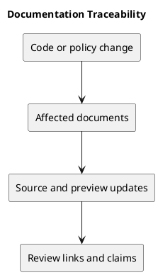

# Documentation Traceability

## Documentation map

| Topic | Documentation | Authoritative evidence |
| --- | --- | --- |
| Product scope | Project-Definition | README and implemented capabilities. |
| Management process | This folder | Explicit decisions and working proposals. |
| Released behavior | CHANGELOG.md | Release tags, commits, and checks. |
| Build and test process | CI workflow | Workflow configuration. |

## Update rules

When a change affects behavior, identify the documents it invalidates. Update their links, diagrams, and claims in the same change where practical. Historical release notes remain historical; corrections should be clearly identified.

Documentation traceability tracks descriptions and evidence. Feature traceability is covered separately in traceability.md.

## Related evidence

- [Project definition](../Project-Definition/README.md)
- [Release history](../../CHANGELOG.md)
- [CI configuration](../../.github/workflows/ci.yml)

## PlantUML diagram

[Editable source](diagrams/documentation-traceability.puml)

