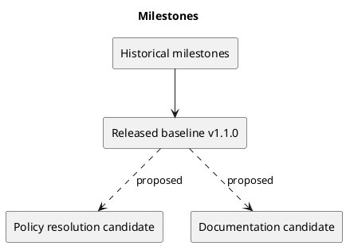

# Milestones

## Historical references

The existing milestone documents remain at their original paths. They describe development stages; this index does not assert new dates or completion evidence beyond those documents.

- [Milestone 5](../MILESTONE_5.md)
- [Milestone 6](../MILESTONE_6.md)
- [Milestone 7](../MILESTONE_7.md)
- [Milestone 8](../MILESTONE_8.md)

## Released baseline

v1.1.0 records the theme and UI release in the changelog. Later metadata styling and documentation commits do not create a new release tag by themselves.

## Proposed next milestone

Close the membership-policy decision and verify enforcement, then consolidate user and operational documentation. These are candidates, not scheduled commitments.

## Related evidence

- [Project definition](../Project-Definition/README.md)
- [Release history](../../CHANGELOG.md)
- [CI configuration](../../.github/workflows/ci.yml)

## PlantUML diagram

[Editable source](diagrams/milestones.puml)

