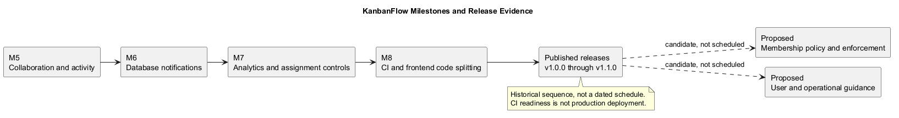
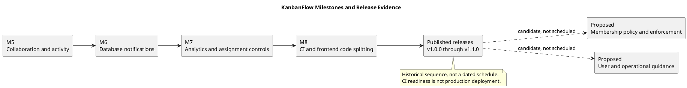

# KanbanFlow Milestones

## Purpose and historical boundary

This index summarizes the milestone records available in the repository, connects them to source evidence, and separates historical work from future candidates. A milestone groups a coherent outcome; it is not necessarily a sprint or a published release.

Historical documents are stored in [Milestones](Milestones/). Their reported completion and validation are historical claims, not fresh test results. This index does not invent dates, owners, capacity, or delivery commitments.

## Historical milestone register

| Milestone | Outcome | Recorded completion | Source reference |
| --- | --- | --- | --- |
| [5 — Collaboration and activity](Milestones/MILESTONE_5.md) | Task comments and workspace activity history. | Completed after PR #29; commit cc326c6. | Historical record lists PRs #26–#29. |
| [6 — Notifications](Milestones/MILESTONE_6.md) | Database notifications for task assignments/reassignments and notification interface. | Completed after PR #31; commit b02b0b5. | Historical record lists PRs #30–#31. |
| [7 — Analytics and task assignment](Milestones/MILESTONE_7.md) | Workspace summaries, deadline/personal task views, and assignee controls. | Completed after PR #35; commit 1e85e85. | Historical record lists PRs #33–#35. |
| [8 — CI and release readiness](Milestones/MILESTONE_8.md) | Automated checks and frontend route-based code splitting. | Completed after PR #37; commit a09155d. | Historical record describes CI and historical build/test results. |

The available folder contains milestones 5–8. This index does not reconstruct missing earlier milestone records.

## Outcome details

### Milestone 5 — Collaboration and activity

The historical scope includes comment authorship, task discussion, authorization, activity logging, and a filtered activity feed. Later releases refined private-board and removed-member access behavior; consult release records when assessing current security claims.

### Milestone 6 — Notifications

The historical scope includes persistent in-app assignment/reassignment notifications, duplicate prevention, authenticated notification endpoints, and unread-state management. It does not promise email or SMS delivery.

### Milestone 7 — Analytics and assignment

The historical scope includes workspace statistics, project/task distributions, deadline views, personal task tracking, and assignee controls. v1.0.2 later corrected analytics refresh after project mutations; milestone completion does not imply the absence of later defects.

### Milestone 8 — CI and release readiness

The historical record reports backend/frontend automation and production-build improvements. Current [CI configuration](../../.github/workflows/ci.yml) runs backend tests and frontend lint/build on main pushes and pull requests into main.

The historical title “Production Readiness” does not establish deployment, uptime, backup restoration, browser support, or a security certification. Those boundaries require separate environment evidence.

## Milestones, sprints, and releases

| Record | Meaning | Evidence |
| --- | --- | --- |
| Milestone | A coherent historical or planned product/project outcome. | Outcome criteria and implementation references. |
| Sprint | An agreed work interval and goal. | Actual dates, selected items, review, and retrospective when recorded. |
| Release | Published source/version delivery. | Exact tag, release notes, and validation records. |

Use [sprint guides](../Sprints/README.md) for planning and actual sprint records. Do not infer sprint history from milestone commits.

## Published release baseline

The [release index](../Releases/README.md) records v1.0.0, v1.0.1, v1.0.2, and v1.1.0. v1.1.0 introduced themes and broader UI improvements.

Milestone numbers and release versions are independent. Later styling or documentation commits do not automatically create a new release or milestone. Use the [changelog](../../CHANGELOG.md) for published change history and inspect Git history for untagged source changes.

## Proposed next milestone candidates

| Candidate | Dependency | Proposed completion evidence | State |
| --- | --- | --- | --- |
| Membership-policy closure | Explicit agreement on manager add/remove and role assignment. | Backend enforcement and direct/indirect role-change regression checks; updated interface feedback and documentation. | Policy blocked; no scheduled date. |
| User guidance | Agreed journeys and final behavior. | Instructions exercised against the demo by representative users. | Proposed. |
| Operational recovery guidance | Target environment and backup/recovery decisions. | Isolated restore evidence and clear deployment/rollback limits. | Proposed. |

These candidates are not approved scope or dated delivery commitments. Track them through the [product backlog](product-backlog.md), [roadmap](roadmap.md), and [decision register](decision-register.md). The known membership loophole remains unresolved.

## Milestone record template

| Field | What to record |
| --- | --- |
| Identifier and title | Stable milestone reference and coherent outcome. |
| Scope and exclusions | Included capabilities and explicit boundaries. |
| Dependencies | Required decisions, earlier work, and environment needs. |
| Completion criteria | Observable outcomes and relevant failure/permission checks. |
| Implementation | Actual commits and pull requests. |
| Verification | Exact tested commit/environment, scenarios, results, and gaps. |
| State and date | Actual status and completion date when evidenced; otherwise not recorded. |
| Residual risks | Open defects and operational limitations. |
| Related delivery | Sprint or release references only when they exist. |

## Completion and verification rules

Mark a milestone complete only when its agreed outcomes are demonstrated. Do not equate merged source, passing build, or a release tag with every acceptance criterion.

Backend tests use SQLite in the configured test environment; MySQL contention and browser usability require relevant separate checks. Use the [quality plan](quality-and-risk-plan.md) and [verification template](../Releases/verification-template.md) to record evidence.

Historical results remain attached to their historical version. Corrections and newly discovered defects should be identified explicitly rather than silently rewriting completion evidence.

## Maintenance

Keep inbound links and README trees updated when moving records. Preserve historical source documents, record missing evidence honestly, and update candidate status only when an actual decision or result changes it. Synchronize PlantUML source and preview.

## PlantUML diagram

[Editable source](diagrams/milestones.puml)

