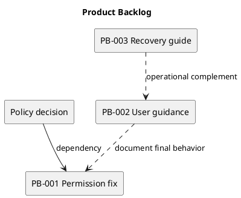

# Product Backlog

This is a proposed planning backlog, not an imported GitHub issue list. Priority and assignment require agreement.

| ID | Candidate | Acceptance target | State |
| --- | --- | --- | --- |
| PB-001 | Resolve manager membership loophole | Remove/re-add cannot bypass the agreed role policy; backend checks cover it. | Policy decision needed. |
| PB-002 | Add user guidance | A new user can follow workspace-to-task instructions against the demo. | Proposed. |
| PB-003 | Document backup and recovery | Operator can follow verified restore steps in an isolated environment. | Proposed. |
| PB-004 | Maintain diagram previews | Sources and images remain synchronized and links resolve. | Ongoing documentation practice. |

Track dependencies and actual delivery in issues or pull requests when those records exist.

## Related evidence

- [Project definition](../Project-Definition/README.md)
- [Release history](../../CHANGELOG.md)
- [CI configuration](../../.github/workflows/ci.yml)

## PlantUML diagram

[Editable source](diagrams/product-backlog.puml)

