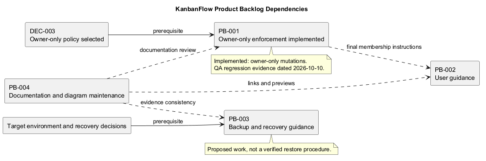
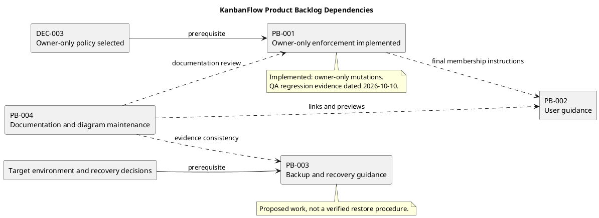

# KanbanFlow Product Backlog

> **Policy amendment (2026-10-10):** Membership mutations are now owner-only; DEC-003/PB-001's bypass is fixed. Current guidance below reflects this rule; historical records retain their original scope. See [QA corrections](../SDLC/06-testing/qa-corrections-2026-10-10.md) for the selected rule and regression evidence.

## Purpose and current boundary

This backlog records candidate improvements, one known defect, and ongoing documentation work. It is a planning record, not an imported GitHub issue list, sprint commitment, or assertion that all items are ready.

The stable IDs PB-001 through PB-004 are retained. Named owners, estimates, delivery dates, and a final priority order have not been agreed. Do not infer them from table position or repository history.

## Backlog index

| ID | Outcome | Dependency | State |
| --- | --- | --- | --- |
| PB-001 | Close the manager remove/re-add role-change loophole. | DEC-003 membership policy agreement. | Implemented locally; owner-only membership enforcement. |
| PB-002 | Provide verified user guidance for core journeys. | Agreed journeys and behavior; final membership guidance depends on PB-001. | Proposed. |
| PB-003 | Provide environment-specific, verified backup and recovery guidance. | Target environment, recovery decisions, and isolated test setup. | Proposed. |
| PB-004 | Keep documentation claims, links, sources, and previews consistent. | Changes to source, policy, paths, and releases. | Ongoing maintenance practice; no permanent completion claim. |

## PB-001 — Membership enforcement

### Problem and outcome

Before the 2026-10-10 correction, managers could bypass owner-only role changes by removing and re-adding a member with a different role. The desired outcome is consistent backend enforcement across direct and indirect membership operations.

### Acceptance criteria for the selected policy

- Direct role updates follow the agreed rules.
- Addition, removal, and re-addition cannot bypass those rules.
- Backend checks reject unauthorized requests independently of frontend controls.
- Current membership and relevant owner protections are covered.
- Rejected operations leave persisted membership unchanged and produce clear feedback.
- Relevant regression checks and affected UI/documentation updates demonstrate the final behavior.

### Dependencies, exclusions, and state

DEC-003 selected owner-only membership mutations on 2026-10-10. Implementation and API regressions close the bypass locally; the earlier problem description records its original motivation.

Exclude unrelated role redesign or account administration. The item is implemented locally under the owner-only rule. See DEC-003 and the 2026-10-10 QA correction for implementation and regression evidence; deployment requires separate verification.

## PB-002 — User guidance

### Need and outcome

Users need instructions for signing in, navigating the collaboration hierarchy, creating permitted work, and understanding rejected actions. The desired outcome is guidance exercised against the actual demo rather than instructions inferred from screenshots.

### Acceptance criteria

- A representative user can follow the workspace-to-task journey without missing steps.
- Role-dependent actions and private-resource access are described without promising unavailable permissions.
- Task assignment, movement, applicable WIP rejection, and saved state are covered.
- Relevant keyboard, theme, and narrow-layout guidance matches the interface.
- Links resolve and examples avoid real credentials or personal data.
- Observed difficulties and the tested commit/environment are recorded.

### Dependencies and state

Agree representative journeys and scope before implementation. Basic guidance can progress independently, but final membership instructions must follow the policy outcome from PB-001. No dedicated complete user-guide section or observed user-research record is claimed by this entry. State: proposed.

## PB-003 — Backup and recovery guidance

### Need and outcome

Operators need an environment-specific way to protect and recover application data and configuration. Existing release rollback guidance is conceptual and does not demonstrate a successful restore.

### Acceptance criteria

- Identify target environment, database, backup responsibility, and agreed retention/recovery requirements.
- Document protected backup contents and configuration handling without exposing secrets.
- Exercise restoration in an isolated authorized environment.
- Verify recovered data and core journeys, recording exact evidence and limitations.
- Explain code/assets/configuration compatibility and the difference between code rollback and data recovery.
- State failures, unverified steps, and authorization required for production operations.

### Dependencies and state

Requires operational decisions and an isolated restore setup. Exclude unapproved production writes or destructive restore experiments. No numerical recovery objective or verified production procedure is implied. State: proposed.

## PB-004 — Documentation consistency

### Need and outcome

Documentation, inline PlantUML, standalone source files, and image previews can drift after changes. The desired outcome is accurate, navigable guidance tied to source evidence.

### Acceptance criteria for each affected change

- Referenced files and folders exist at their documented paths.
- Inline PlantUML matches standalone source and the preview is regenerated.
- Claims distinguish implementation, proposals, historical results, and fresh evidence.
- Version and release references do not label untagged commits as a published patch.
- Moves update inbound links, local references, and README trees.
- Scoped review records unresolved evidence gaps honestly.

### State

Ongoing maintenance practice. Many documents and previews already exist; this item does not mean they are all missing or continuously verified. Complete individual maintenance slices with evidence and keep the practice active.

## Priority and selection

Review known authorization defects explicitly before lower-risk improvements. This is a risk-review recommendation, not an agreed numbered priority or release deadline.

Select work using user impact, security/data consequences, dependencies, readiness, and actual capacity. A policy-blocked item may require a decision task first. Do not assign estimates or sprint ownership without agreement.

## Refinement and state transitions

Use [backlog refinement](backlog-refinement.md) before selecting an item. States may include Proposed, Needs clarification, Blocked, Ready, In progress, In review, Verified, Done, or Deferred.

Ready means scope and evidence are understood; Done means agreed criteria are demonstrated. An open defect is not resolved by documentation, a merged unrelated commit, or a passing general build.

## Item template and traceability

For a new candidate, record ID, user problem, evidence, affected roles, desired outcome, scope/exclusions, acceptance criteria, dependencies, state, next action, and actual owners/estimates when agreed.

Link decisions, implementation commits or pull requests, check results, and release records through [traceability](traceability.md). A local record is not automatically synchronized with GitHub Issues.

## Verification boundaries

Backend SQLite tests do not establish MySQL contention safety. Lint/build do not establish browser usability or restore correctness. Use the [quality plan](quality-and-risk-plan.md), [definition of ready](../Sprints/definition-of-ready.md), [definition of done](../Sprints/definition-of-done.md), and [verification template](../Releases/verification-template.md).

Record the exact tested commit and environment. Keep skipped criteria, blockers, and residual risks explicit.

## Maintenance

Update item states only when decisions or evidence change. Retain stable IDs, record deferred reasons and superseding work, and review dependencies during planning. Regenerate the PlantUML preview when the dependency graph changes.

## PlantUML diagram

[Editable source](diagrams/product-backlog.puml)

