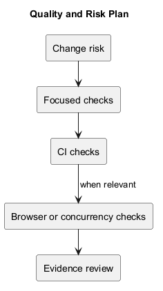
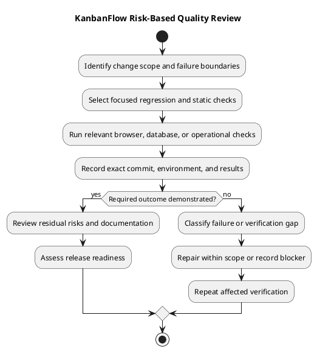

# KanbanFlow Quality and Risk Plan

> **Policy amendment (2026-10-10):** Membership mutations are now owner-only; DEC-003/PB-001's bypass is fixed. Current guidance below reflects this rule; historical records retain their original scope. See [QA corrections](../SDLC/06-testing/qa-corrections-2026-10-10.md) for the selected rule and regression evidence.

## Purpose and status

This plan defines how to choose verification proportional to the affected behavior and risk. It connects engineering checks, user journeys, authorization, data integrity, documentation, and operational readiness.

It is a working strategy, not a claim that every scenario has been executed for the current commit. Historical release results remain historical. No numerical coverage, uptime, performance, or defect-rate target is established here.

## Quality objectives

- Accepted changes persist and remain consistent after refresh.
- Access follows the agreed membership and visibility policy.
- Ordering and applicable WIP limits remain valid under relevant competing operations.
- Failures produce clear feedback and recover optimistic state.
- Affected journeys remain usable with keyboard and narrow layouts.
- Documents and diagrams match implementation and evidence.
- Deployment and recovery claims are supported by environment-specific checks.

The manager remove/re-add loophole was corrected through owner-only membership mutations; preserve direct/indirect regression coverage.

## Current automated baseline

| Check | Configured command or evidence | Scope and limitation |
| --- | --- | --- |
| Backend tests | php artisan test from backend | [PHPUnit](../../backend/phpunit.xml) uses in-memory SQLite; does not prove MySQL contention. |
| Frontend lint | npm run lint from frontend | Static rules, not runtime user journeys. |
| Type/build | npm run build from frontend | Runs TypeScript and Vite build; not accessibility or production behavior proof. |
| CI | [Workflow](../../.github/workflows/ci.yml) | Backend tests and frontend lint/build on main pushes and pull requests into main. |

CI uses PHP 8.4 and Node.js 24 in the checked-in workflow. It does not automatically run browser journeys, publish releases, deploy, or restore backups.

## Risk register and check selection

| Risk | Required response when affected |
| --- | --- |
| Manager indirect role-change bypass | Preserve the owner-only DEC-003 rule and regression-test direct and remove/re-add rejection paths. |
| Private or nested resource exposure | Test membership, visibility, current access, and direct API requests. |
| Session/origin mismatch | Exercise registration, login/logout, expired sessions, and existing-session redirects with actual configured hosts. |
| Concurrent WIP/ordering conflicts | Run relevant backend checks and isolated MySQL contention/stale-state scenarios. |
| Failed optimistic mutation | Observe error feedback, rollback, cache refresh, and server state after reload. |
| Keyboard/layout/theme regression | Exercise focus, dialogs, movement handles, narrow layouts, contrast/readability, and saved preference. |
| Upgrade or recovery failure | Assess compatibility and verify authorized environment-specific smoke/restore procedures. |
| Documentation drift | Check claims, paths, inline/standalone PlantUML, and rendered previews. |

Use [risks and success criteria](../Project-Definition/risks-and-success-criteria.md) for stable risk/criterion references.

## Critical journey matrix

| Journey | Normal path | Relevant failure or boundary |
| --- | --- | --- |
| Authentication | Register, sign in, sign out, restore an existing session. | Invalid inputs, rate limit, expired session, unavailable service. |
| Workspace/project/board | Open or create permitted resources. | Invalid identifiers, missing resources, denied membership, private visibility. |
| Task workflow | Create, edit, assign, complete, and move tasks. | Invalid destination, full WIP column, stale state, rejected mutation. |
| Collaboration | Read/add/edit permitted comments and inspect activity/notifications. | Removed membership, unauthorized author/resource, visibility-sensitive data. |
| Interface | Search, navigate, select themes, use dialogs and move handles. | Empty results, focus escape/restoration, narrow layouts, refresh persistence. |

Select affected rows rather than rerunning every unrelated journey after a low-impact change. Broaden checks when failures or unresolved risks justify it.

## Verification sequence

1. Inspect requirements, affected source, configuration, and existing checks.
2. For defects, reproduce the failure and identify the cause.
3. Select observable criteria and proportionate regression checks.
4. Verify the focused change, then relevant static/build and integration checks.
5. Exercise affected runtime boundaries, including direct denied requests.
6. Inspect persisted state and UI agreement after failures and refresh.
7. Record exact commit/environment evidence and unresolved gaps.
8. Review documentation, residual risk, and release implications.

Do not substitute implementation-mirroring tests for user outcomes. Avoid adding a new testing framework solely for a small documentation or styling edit.

## Test environment and data

Use authorized local or isolated test environments. Keep production records, real credentials, and personal details out of test artifacts. Confirm database isolation before migrations, contention experiments, or restore exercises.

Separate SQLite automated evidence from MySQL concurrency evidence. Identify runtime versions, browser, database engine, configuration assumptions, and test-data lifecycle. Never assume a successful code rollback restores data.

## Failure handling

| Classification | Response |
| --- | --- |
| Product defect | Record reproduction, impact, and scoped correction; rerun relevant checks. |
| Test defect | Explain the incorrect expectation/setup and verify the correction. |
| Environment limitation | State the missing service/configuration and what remains unverified. |
| Flaky result | Investigate and record variability; do not hide it with retries. |
| Unrelated pre-existing failure | Identify evidence and scope; do not silently treat it as a pass. |

A skipped required check remains a verification gap. An elapsed wait or passing unrelated check does not resolve it.

## Evidence record

Record the exact commit, check command/scenario, environment, result, logs or links, and known limitations. Use the [release verification template](../Releases/verification-template.md).

Counts are useful context, not proof that every requirement is covered. Historical results from the [release records](../Releases/README.md) must not be reused as fresh verification for later code.

## Completion and release review

Use the [definition of done](../Sprints/definition-of-done.md) for scoped work. Before publication, follow the [release checklist](../Releases/release-checklist.md) and review applicable upgrade/recovery implications.

Required criteria must be demonstrated or explicitly recorded as unmet with a review decision. Open security and integrity defects must remain visible in notes; no documentation update alone closes the membership loophole. Publication and deployment are separate authorized actions.

## Responsibilities and maintenance

Maintainers select and execute scoped checks, reviewers assess evidence, operators validate environment/recovery boundaries, and participating users provide observed usability feedback. These are responsibilities, not named assignments.

Update this plan when CI, runtime, data flows, permission rules, or user journeys change. Link work through [traceability](traceability.md), keep [documentation traceability](documentation-traceability.md) current, and synchronize diagram sources/previews.

## PlantUML diagram

[Editable source](diagrams/quality-and-risk-plan.puml)

