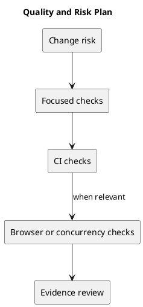

# Quality and Risk Plan

## Verification strategy

Use affected backend tests for authorization, persistence, and WIP behavior. Use frontend lint and production build for static checks. Use browser journeys for themes, keyboard interaction, responsive layout, and optimistic-update rollback.

CI currently runs backend tests and frontend lint/build on main pushes and pull requests into main. It does not automatically establish browser usability or MySQL concurrency correctness.

## Key risks

| Risk | Mitigation |
| --- | --- |
| Membership policy bypass | Resolve policy and add authorization regression checks. |
| Concurrent WIP or ordering failures | Run relevant isolated MySQL contention checks after changes. |
| Authentication configuration errors | Verify session flows with deployment-specific URLs. |
| Stale documentation | Review evidence, links, and generated previews. |

Record check environment, commit, result, and any unverified boundaries. Keep production data out of tests.

## Related evidence

- [Project definition](../Project-Definition/README.md)
- [Release history](../../CHANGELOG.md)
- [CI configuration](../../.github/workflows/ci.yml)

## PlantUML diagram

[Editable source](diagrams/quality-and-risk-plan.puml)

