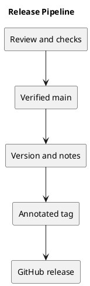

# Release Pipeline

## Current automation

The CI workflow runs backend tests and frontend lint/build for pushes to main and pull requests targeting main. It does not deploy the application or automatically create tags and releases.

## Proposed release sequence

1. Review the scoped change and update relevant documentation.
2. Run proportionate local checks and confirm CI.
3. Merge the reviewed change and verify the resulting main commit.
4. Choose the version, update release metadata, and document upgrade effects.
5. Create an annotated tag on the verified release commit.
6. Publish release notes and verify remote tag and commit alignment.

Publishing and deployment require authorization for the specific action. A GitHub release is not evidence of production deployment. Never silently move an existing released tag.

## Related evidence

- [Project definition](../Project-Definition/README.md)
- [Release history](../../CHANGELOG.md)
- [CI configuration](../../.github/workflows/ci.yml)

## PlantUML diagram

[Editable source](diagrams/release-pipeline.puml)

