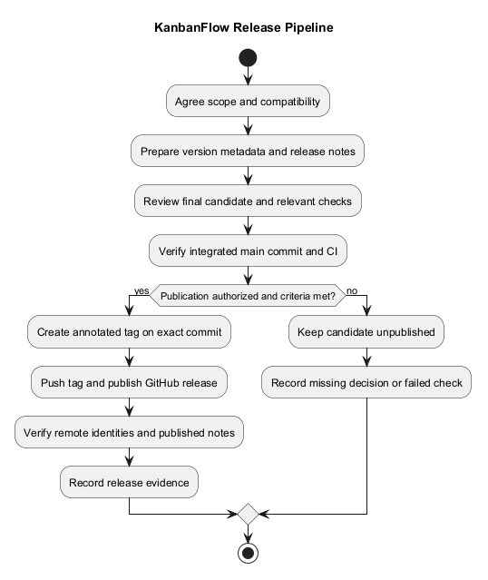
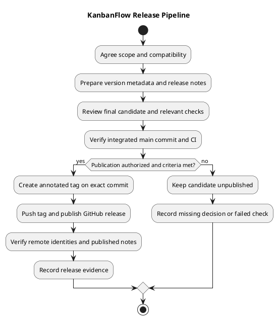

# KanbanFlow Release Pipeline

## Purpose and current status

This guide describes source-release preparation, verification, tagging, publication, and final identity checks. It is a working manual process supported by CI, not an automatic deployment pipeline.

A commit on main, a successful workflow, an annotated tag, a GitHub release, and a running deployment are distinct states. Do not claim a later state from evidence of an earlier one.

## Current automation

The [CI workflow](../../.github/workflows/ci.yml) runs for pushes to main and pull requests targeting main.

| Job | Current behavior | Boundary |
| --- | --- | --- |
| Backend Tests | PHP 8.4, Composer dependencies, test environment/key setup, Laravel tests. | Tests use SQLite configuration; do not establish MySQL contention. |
| Frontend Build and Lint | Node.js 24, npm ci, lint, and TypeScript/Vite build. | Does not establish browser usability or production runtime. |

Workflow permissions are contents: read. The workflow does not automatically create tags, publish releases, deploy services, or restore backups. Successful checks on an earlier commit are not proof of the final release commit.

## Release inputs

- Agreed scope and release candidate.
- Compatibility assessment for APIs, behavior, data, configuration, and dependencies.
- Relevant acceptance and risk criteria.
- Actual authorization for publication.
- Version choice and complete change/upgrade notes.
- Fresh check evidence and known limitations.

Use the [version policy](versioning-strategy.md), [quality plan](quality-and-risk-plan.md), and [release checklist](../Releases/release-checklist.md).

## Stage 1 — Scope and compatibility

Identify what changes from the previous published version and which users are affected. Review migrations, environment changes, dependency updates, and security consequences.

Do not label documentation or later main commits as a published patch without a real version/tag/release. Existing published tags must not be silently moved or reused.

## Stage 2 — Metadata and notes

Align frontend package and lockfile version metadata, README version, changelog, release notes, and planned tag. Record user-visible behavior, fresh validation, upgrades, and known issues.

Prepare metadata before verifying the final candidate. If any source or metadata changes afterward, inspect the new commit and rerun affected checks; do not tag an unverified follow-up merely because an earlier candidate passed.

## Stage 3 — Review and verification

Review the scoped diff and demonstrate the agreed criteria. Run relevant backend checks, frontend lint/build, and affected browser or concurrency scenarios. Check documentation links and diagram consistency.

Integrate the reviewed change into main using the agreed workflow. Verify the resulting exact commit and its CI result. A pull request is a review mechanism; this guide does not invent mandatory branch-protection rules.

Record commit, environment, commands/scenarios, results, and gaps using the [verification template](../Releases/verification-template.md). Link the v1.1.1 owner-only membership correction and recheck affected candidates; preserve historical issue wording in older release records.

## Stage 4 — Publication readiness

| Gate | Required evidence |
| --- | --- |
| Scope | Changes and exclusions are understood. |
| Version | Metadata and planned tag agree. |
| Verification | Relevant criteria demonstrated for the exact candidate; gaps explicit. |
| Compatibility | Upgrade/data/configuration effects documented. |
| Repository | Candidate identity confirmed and no unrelated pending work included. |
| Authorization | Publication is within the explicitly authorized action. |

A failed required criterion remains failed or pending. Record an explicit review decision for unresolved risk rather than silently declaring readiness.

## Stage 5 — Tag and publish

Create an annotated release tag on the verified commit. Confirm that the version is unused locally and remotely before publishing it. Push the exact tag and publish notes that describe changes, validation, upgrade effects, and known issues.

Use the [release notes template](../Releases/release-notes-template.md). A tag push alone does not establish that GitHub release notes were published; verify both operations.

## Stage 6 — Final verification

- Resolve the remote tag to its exact commit and compare with the intended release.
- Verify the published release's tag, title, notes, and draft/prerelease state.
- Confirm local and remote main identity when synchronization is part of the task.
- Confirm no unrelated working changes were lost or included.
- Link the published release, comparison, and actual CI evidence.
- Record remaining issues and operational limitations.

Tag identity is the release anchor. Main may legitimately advance after publication; that does not retarget the release.

## Publication failures and recovery

| Failure | Response |
| --- | --- |
| Commit succeeds but push fails | Preserve the commit and inspect the remote state before retrying. |
| Tag pushes but release creation fails | Verify the existing tag and whether a release exists; retry creation without retagging. |
| API or Git transport reports an error | Verify remote identity; an error message alone may not describe final state. |
| Release notes contain a factual error | Make an explicit notes/documentation correction; preserve source-tag integrity. |
| Released code needs a fix | Prepare a new version with verification rather than silently replacing the released tag. |

Keep retries bounded and diagnose repeated failures. Never reset or recreate the repository merely because publication failed.

## Deployment and rollback boundary

Deployment requires separate environment-specific authorization and evidence. CI/source publication does not demonstrate service availability, smoke checks, data compatibility, or recovery.

Review [upgrade and rollback guidance](../Releases/upgrade-and-rollback.md). Code rollback does not restore database records, and older security behavior can reintroduce defects. Data restoration needs its own verified procedure and authorized scope.

## Release history and maintenance

Use the [release index](../Releases/README.md) and [changelog](../../CHANGELOG.md) for historical records. Keep [unreleased changes](../Releases/unreleased.md) distinct from published versions.

Update this pipeline when triggers, jobs, permissions, publication tooling, metadata, or deployment responsibilities change. Keep the inline/standalone PlantUML and preview synchronized. This documentation change does not create a new release.

## PlantUML diagram

[Editable source](diagrams/release-pipeline.puml)

