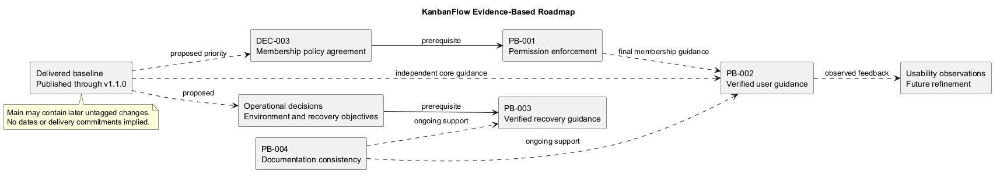
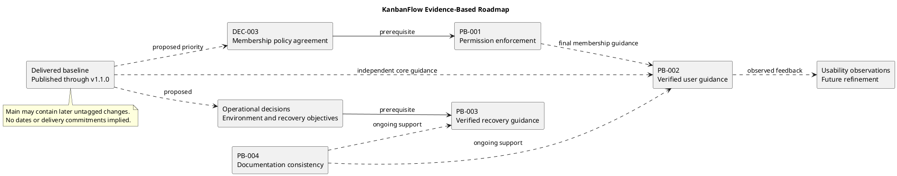

# KanbanFlow Roadmap

> **Policy amendment (2026-10-10):** Membership mutations are now owner-only; DEC-003/PB-001's bypass is fixed. Earlier open-policy text and diagrams below describe the preceding state. See [QA corrections](../SDLC/06-testing/qa-corrections-2026-10-10.md) for the selected rule and regression evidence.

## Purpose and planning status

This roadmap connects delivered capabilities to proposed improvements and their dependencies. It communicates direction rather than a dated delivery schedule.

No named owners, estimates, sprint commitments, release deadlines, or guaranteed future features are established here. Proposed priorities require agreement and refinement. Completion requires implementation and verification evidence, not a roadmap edit.

## Delivered baseline

KanbanFlow supports authenticated workspace collaboration, projects, boards, ordered columns/tasks, assignments, WIP limits, comments, activity, database notifications, workspace analytics, resource-list search, and themes.

| Published baseline | Main focus | Evidence |
| --- | --- | --- |
| v1.0.0 | Initial portfolio feature set. | [Release record](../Releases/v1.0.0.md). |
| v1.0.1 | Privacy, authorization, and Kanban interactions. | [Release record](../Releases/v1.0.1.md). |
| v1.0.2 | Local session configuration, analytics refresh, and naming. | [Release record](../Releases/v1.0.2.md). |
| v1.1.0 | Themes and broader UI/UX improvements. | [Release record](../Releases/v1.1.0.md). |

Main includes later source and documentation changes without a new published version. Use the [changelog](../../CHANGELOG.md), tags, and Git history to distinguish released behavior from later commits.

Delivered capabilities do not imply every scenario is defect-free. The manager remove/re-add role-change loophole remains open.

## Proposed horizons

### First — Resolve membership policy and enforcement

The known authorization gap deserves explicit priority review. Agree manager add/remove and role-assignment rules in DEC-003, then refine PB-001 and implement consistent backend enforcement across direct and indirect role changes.

Completion evidence includes the agreed rule, backend regression coverage, affected UI feedback, persisted-state checks for rejected operations, and updated documentation. Until closure, owners should manage membership. This is a dependency-bound candidate, not a scheduled fix.

### Next — Verified user guidance

Develop instructions for authentication, workspace-to-task navigation, assignments, movement, WIP rejection, saved state, and relevant keyboard/theme behavior.

Basic journey guidance can progress independently; final membership instructions must reflect the completed policy outcome. Completion requires instructions exercised against the actual demo, valid links, and recorded observed difficulties. No user research result is inferred from current documentation.

### Next — Operational and recovery guidance

Agree the target environment, backup responsibility, retention/recovery expectations, and authorized isolated test setup. Document configuration, deployment smoke checks, compatible rollback, and backup restoration.

Completion requires a demonstrated isolated restore with limitations and evidence. Current conceptual upgrade guidance is not a verified production procedure or numerical recovery guarantee.

### Continuous — Usability and documentation review

Use observed keyboard, narrow-layout, focus, theme, error, and core-journey difficulties to refine future candidates. Maintain documentation claims, links, diagram sources, and previews as behavior changes.

This is ongoing work, not a permanently completed milestone. New feature proposals must remain within agreed scope or pass a scope-change decision.

## Roadmap-to-backlog map

| Direction | Existing reference | Key dependency | State |
| --- | --- | --- | --- |
| Membership enforcement | [PB-001](product-backlog.md), [DEC-003](decision-register.md) | Explicit policy decision. | Policy blocked. |
| User guidance | PB-002 | Agreed journeys; final membership instructions depend on PB-001. | Proposed. |
| Recovery guidance | PB-003 | Operational decisions and isolated restore environment. | Proposed. |
| Documentation consistency | PB-004 | Affected changes and evidence. | Ongoing practice. |
| Usability improvements | Observations refined into future items | Actual observed problem and agreed scope. | No new committed item inferred. |

Stable IDs connect planning to implementation. Table order does not assign a final numbered priority, owner, or delivery date.

## Dependency and parallel-work boundaries

Policy agreement precedes membership enforcement. Operational decisions precede validated recovery procedures. General user guidance and documentation maintenance can progress without inventing those unresolved outcomes.

Choose independent work only when it preserves the accepted goal and does not replace missing policy with assumptions. No concurrent execution requirement is imposed by the diagram.

## Prioritization criteria

Review user impact, security and data-integrity consequences, dependencies, uncertainty, and actual capacity. Prefer observable outcomes that can be verified safely.

Do not use unsupported probability scores, invented customer demand, or repository task counts as a productivity baseline. Estimates and schedules are recorded only when agreed.

## Selection and completion process

1. Confirm the user problem and evidence.
2. Assess [scope boundaries](../Project-Definition/scope-boundary-diagram.md) and affected roles.
3. Refine the candidate using [backlog refinement](backlog-refinement.md).
4. Resolve decisions and apply the [definition of ready](../Sprints/definition-of-ready.md).
5. Agree a work goal and actual capacity when selecting a sprint.
6. Demonstrate the [definition of done](../Sprints/definition-of-done.md) with exact evidence.
7. Update backlog, milestone, and release records only when outcomes justify the new state.

A source merge is not automatic release publication or deployment authorization.

## Success and verification

Use the [product goals](../Project-Definition/overview-and-goals.md) and [risk criteria](../Project-Definition/risks-and-success-criteria.md) to judge outcomes. Record the exact commit and environment.

Automated checks do not establish every runtime boundary: browser usability, MySQL contention, deployment, and restore behavior require relevant separate checks. Historical release results remain historical.

## Review and maintenance

Revisit the roadmap when confirmed defects, user observations, policy decisions, completed work, or operational constraints change. Record why priorities or scope changed, preserving delivered history.

Use [milestones](milestones.md) for historical stages, [sprint guides](../Sprints/README.md) for agreed work intervals, and [release guidance](../Releases/README.md) for publication. Keep proposed horizons separate from these actual delivery records.

Regenerate the diagram preview whenever dependencies or planning direction change.

## PlantUML diagram

[Editable source](diagrams/roadmap.puml)

