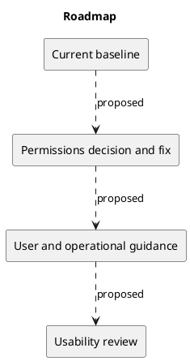

# Roadmap

## Delivered baseline

KanbanFlow supports workspace collaboration, projects, boards, columns, tasks, comments, activity, database notifications, analytics, and themes. Consult the changelog for released details.

## Proposed sequence

- Resolve membership permissions before strengthening authorization claims.
- Improve user onboarding and task-management guidance.
- Document deployment, backups, and recovery with verified procedures.
- Review accessibility and usability through observed user journeys.

There are no committed dates, capacity estimates, or guaranteed future features in this roadmap. Reprioritize using risk, user evidence, and dependencies.

## Related evidence

- [Project definition](../Project-Definition/README.md)
- [Release history](../../CHANGELOG.md)
- [CI configuration](../../.github/workflows/ci.yml)

## PlantUML diagram

[Editable source](diagrams/roadmap.puml)

