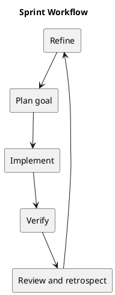

# Sprint Workflow

## Proposed workflow

Refine candidates, select a coherent goal, implement small changes, verify behavior, and review outcomes. Record sprint dates and participants only when agreed; this document does not introduce a mandatory sprint cadence.

## Work item completion

A finished item has its acceptance criteria demonstrated, relevant checks passing, scoped review completed, and affected documentation updated. Track unresolved defects explicitly rather than marking them complete.

## Review and retrospective

Show working behavior and evidence, compare outcomes with the goal, and record one or more actionable improvements for future work.

## Related evidence

- [Project definition](../Project-Definition/README.md)
- [Release history](../../CHANGELOG.md)
- [CI configuration](../../.github/workflows/ci.yml)

## PlantUML diagram

[Editable source](diagrams/sprint-workflow.puml)

