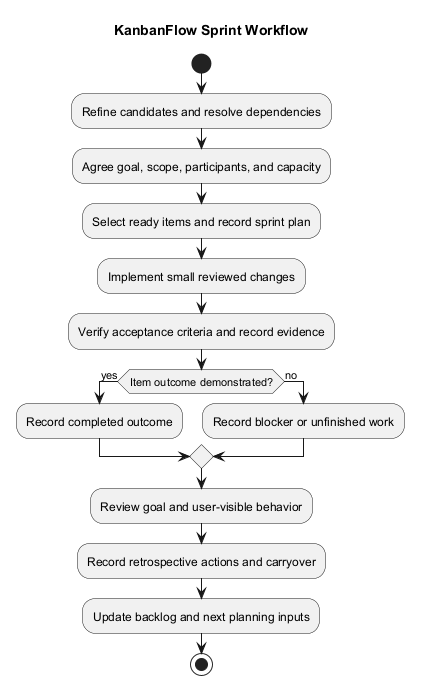
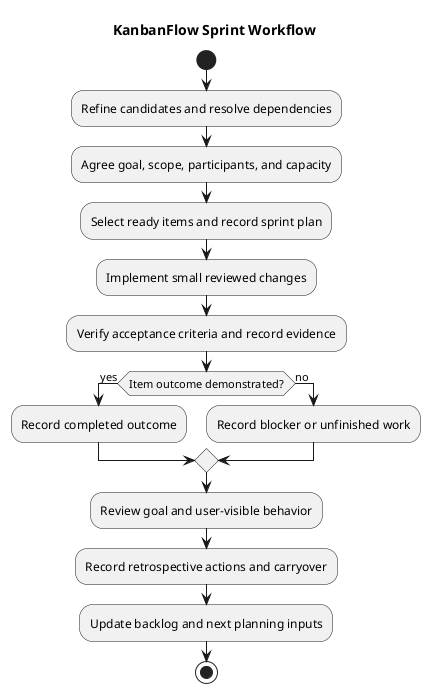

# KanbanFlow Sprint Workflow

> **Policy amendment (2026-10-10):** Membership mutations are now owner-only; DEC-003/PB-001's bypass is fixed. Earlier open-policy text and diagrams below describe the preceding state. See [QA corrections](../SDLC/06-testing/qa-corrections-2026-10-10.md) for the selected rule and regression evidence.

## Purpose and planning boundary

This guide describes a working sprint process for delivering a coherent outcome with evidence. It connects refinement, planning, implementation, verification, review, and follow-up.

No mandatory sprint length, meeting cadence, named team, capacity baseline, or historical sprint schedule is established here. Record actual participants, dates, goals, and decisions when agreed. Repository commits and milestones do not automatically establish a sprint record.

## Inputs and outputs

| Stage | Inputs | Outputs |
| --- | --- | --- |
| Refinement | Candidate problems, scope, risks, decisions. | Ready items or explicit blockers. |
| Planning | Ready items, agreed goal, actual capacity. | Selected scope and sprint record. |
| Execution | Accepted criteria and dependencies. | Scoped changes, progress, and decisions. |
| Verification | Exact changed commit and authorized environment. | Demonstrated results and known gaps. |
| Review | Working behavior and evidence. | Goal outcome, feedback, unfinished items. |
| Retrospective | Observations from the work. | Concrete improvements and follow-up. |

Use the [sprint kit](../Sprints/README.md) for detailed templates rather than duplicating actual sprint records in this guide.

## 1. Refine candidates

Confirm the user problem, current behavior, affected roles, scope/exclusions, acceptance criteria, and required checks. Identify policy, data, interface, and operational dependencies.

Apply [backlog refinement](backlog-refinement.md) and the [definition of ready](../Sprints/definition-of-ready.md). Ready means the work can be understood and verified, not that it is approved for every external action.

For PB-001, resolve DEC-003 before selecting membership enforcement. Do not infer the final manager rule from role names.

## 2. Plan the sprint goal

Agree a clear outcome rather than an unrelated collection of tasks. Select items against the goal and real capacity. Record:

- Identifier, actual dates, and participants when agreed.
- Goal and observable success criteria.
- Baseline commit and selected backlog IDs.
- Scope, exclusions, dependencies, and known risks.
- Actual owners/estimates when assigned; otherwise mark them unassigned or unestimated.

Use the [planning guide](../Sprints/sprint-planning.md), [backlog template](../Sprints/sprint-backlog.md), and [record template](../Sprints/sprint-record-template.md). Do not invent velocity or deadlines.

## 3. Execute scoped work

Implement small, independently reviewable changes while preserving the agreed outcome and unrelated work. Keep backend authorization, persisted state, failure feedback, and documentation impacts visible.

Track progress and blockers with [daily progress guidance](../Sprints/daily-progress.md). A daily meeting is optional; accurate outcome records are the requirement of this proposed process.

A blocker should identify the missing decision or dependency and the next action. Do not replace an unresolved requirement with an assumed workaround.

## 4. Manage scope changes

When new information changes the work:

1. Describe the finding and its effect on the goal.
2. Assess affected criteria, dependencies, data, and permissions.
3. Record the agreed scope decision.
4. Update selected items and evidence expectations.
5. Carry unrelated candidates back to the product backlog.

Urgency does not make an unverified outcome complete. Preserve the distinction between user steering, approved scope, and newly discovered adjacent work.

## 5. Verify and review changes

Demonstrate acceptance criteria against the exact changed commit. Run relevant backend tests and frontend lint/type/build, plus affected browser or MySQL contention checks where needed.

Record failures, skipped checks, and limitations. SQLite results do not establish MySQL contention; build success does not establish keyboard usability or runtime failure recovery.

Use the [quality plan](quality-and-risk-plan.md), [traceability](traceability.md), and [definition of done](../Sprints/definition-of-done.md). An item remains incomplete when required outcome evidence is missing.

## Work states

| State | Meaning |
| --- | --- |
| Ready | Scope, dependencies, and verification are understood. |
| In progress | Implementation is underway. |
| Blocked | A required decision, dependency, or environment is unavailable. |
| In review | Change and evidence are being assessed. |
| Verified | Relevant criteria are demonstrated with recorded evidence. |
| Done | Agreed completion and documentation requirements are met. |
| Deferred or carryover | Work is not completed in this sprint; reason and next action are recorded. |

These states are planning conventions, not a claim of a configured issue-board automation.

## 6. Sprint review

Restate the goal, demonstrate working behavior, and compare actual outcomes with the selected criteria. Include relevant failures and permission boundaries rather than presenting only the successful path.

Use the [review template](../Sprints/sprint-review.md). Record feedback, incomplete scope, and follow-up backlog items. Do not invent customer approvals or research findings.

Review completion does not automatically authorize release publication or deployment.

## 7. Retrospective and closure

Identify observed practices that helped or hindered delivery. Choose concrete improvements and actual follow-up owners when agreed, using the [retrospective template](../Sprints/sprint-retrospective.md).

Record the final goal outcome, completed items, carryover reasons, tested commits, evidence, decisions, and remaining risks. Keep failed or pending work visible.

Update the backlog and next planning inputs. Use [metrics guidance](../Sprints/sprint-metrics.md) only with agreed definitions and actual records; avoid individual productivity rankings or invented numbers.

## Sprint, milestone, and release boundaries

A sprint is an agreed work interval and goal. A milestone groups a coherent project outcome. A release identifies published source/version delivery. They may relate, but none automatically creates the others.

Link actual [milestone](milestones.md) and [release](../Releases/README.md) records only when they exist. Follow the [release pipeline](release-pipeline.md) for separately authorized publication.

## Responsibilities and maintenance

Scope decision-makers agree outcomes, maintainers implement and verify, reviewers assess evidence, users provide observed feedback, and operators assess environment/recovery needs. These are categories, not staffing assignments.

Update this workflow when actual planning practices, evidence requirements, or delivery responsibilities change. Synchronize the PlantUML source and rendered preview.

## PlantUML diagram

[Editable source](diagrams/sprint-workflow.puml)

