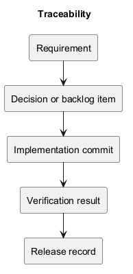
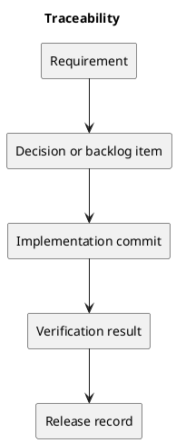

# Traceability

## Feature-to-evidence map

| Concern | Definition or plan | Implementation evidence | Verification |
| --- | --- | --- | --- |
| Session authentication | Project-Definition constraints | Backend routes and authentication flow | Relevant backend/session and browser checks. |
| Task ordering and WIP | Project scope | Task and column backend implementation | Relevant regression and MySQL contention checks. |
| Theme preferences | Overview goals | Frontend theme components | Theme persistence and responsive browser checks. |
| Membership loophole | PB-001 and DEC-003 | Membership policy and controller | Pending final policy and enforcement checks. |

This map names evidence categories, not claims of freshly executed tests. Record exact files, tests, commit IDs, and result links in the implementation or release record when a change is delivered.

Use stable item IDs to connect requirements, decisions, changes, and evidence.

## Related evidence

- [Project definition](../Project-Definition/README.md)
- [Release history](../../CHANGELOG.md)
- [CI configuration](../../.github/workflows/ci.yml)

## PlantUML diagram

[Editable source](diagrams/traceability.puml)

