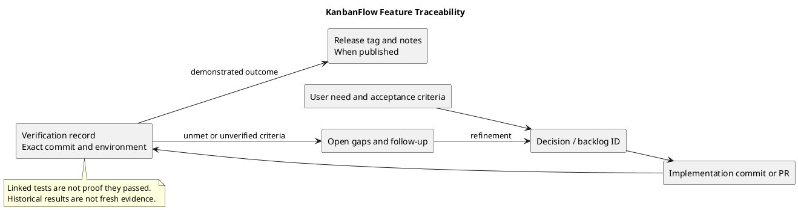

# KanbanFlow Feature Traceability

## Purpose and distinction

Feature traceability links a user need and acceptance criteria to decisions, backlog items, source changes, verification, and published delivery. It supports impact analysis and helps expose missing evidence.

[Documentation traceability](documentation-traceability.md) maps descriptive claims and document maintenance to their sources. This guide follows the feature outcome itself. Neither a source link nor a test filename proves the outcome has been freshly verified.

## Traceability chain

A complete delivery record identifies:

1. The user need and observable acceptance criteria.
2. Relevant decisions and stable backlog references.
3. Implementation files and exact commit or pull request.
4. Verification scenarios, environment, tested commit, and results.
5. Published tag/release when publication actually occurs.
6. Open gaps and follow-up work.

Not every candidate has every stage yet. A blocked decision or unimplemented proposal should remain incomplete rather than receiving invented links or dates.

## Feature-to-evidence map

| Concern | Definition or planning link | Implementation reference | Relevant check reference |
| --- | --- | --- | --- |
| Sessions | [Constraints](../Project-Definition/assumptions-and-constraints.md) | [Sanctum configuration](../../backend/config/sanctum.php) and frontend authentication flows. | [SPA authentication tests](../../backend/tests/Feature/SpaAuthenticationTest.php) and browser session journeys. |
| Membership | [DEC-003](decision-register.md), [PB-001](product-backlog.md) | Backend membership policies and controller. | [Membership tests](../../backend/tests/Feature/WorkspaceMemberApiTest.php); final indirect-role-change enforcement remains pending. |
| Board visibility | [Scope](../Project-Definition/scope-and-stakeholders.md) | [API routes](../../backend/routes/api.php), board and nested-resource access checks. | [Board tests](../../backend/tests/Feature/BoardApiTest.php), [review regressions](../../backend/tests/Feature/ReviewRegressionTest.php). |
| Task ordering and WIP | [Risk criteria](../Project-Definition/risks-and-success-criteria.md) | Backend task/column validation and transactional operations. | [Task tests](../../backend/tests/Feature/TaskApiTest.php), [column tests](../../backend/tests/Feature/ColumnApiTest.php), isolated MySQL contention. |
| Collaboration | [Product overview](../Project-Definition/overview-and-goals.md) | Comments, activity, and notification behavior. | [Comment tests](../../backend/tests/Feature/TaskCommentApiTest.php), [activity tests](../../backend/tests/Feature/ActivityLogApiTest.php), [notification tests](../../backend/tests/Feature/NotificationApiTest.php). |
| Analytics | Product scope and historical v1.0.2 fix. | Workspace analytics and frontend invalidation behavior. | [Analytics tests](../../backend/tests/Feature/WorkspaceAnalyticsApiTest.php) and refresh journeys. |
| Themes | [DEC-002](decision-register.md) | [Theme provider](../../frontend/src/components/theme/ThemeProvider.tsx). | Browser persistence, tab synchronization, readability, and layout checks. |

This table identifies sources and check categories, not fresh execution results or complete coverage. Read the implementation and actual test assertions when evaluating a specific criterion.

## Stable references and evidence identity

Use existing PB and DEC identifiers rather than silently renumbering them. Criterion IDs such as G-01 or SC-03 refer to their defining documents; they are not GitHub issue numbers.

Record full commit SHA and exact tested environment for verification. Use tag/commit references for historical source. Main links help navigation but change as the repository advances.

Link issues and pull requests only when real records exist. A local backlog entry is not automatically synchronized with GitHub Issues.

## Record template

| Field | Required content |
| --- | --- |
| Need/criterion | Definition link, ID, expected observable result. |
| Planning | Backlog/decision reference and unresolved dependencies. |
| Scope | Affected users, resources, interfaces, and exclusions. |
| Implementation | Actual files, full commit SHA, and PR when available. |
| Verification | Command/scenario, environment, result, and evidence link. |
| Gaps | Failed/skipped criteria and next action. |
| Delivery | Published tag/release, or explicitly untagged/unreleased. |
| Documentation | Affected guide/diagram updates. |
| State | Proposed, blocked, implemented, verified, or published as supported by evidence. |

Do not fill unavailable fields with fabricated owners, approvals, test outcomes, or dates.

## KanbanFlow examples

### Membership policy closure

PB-001 depends on DEC-003. Until the manager rule is agreed, the trace ends at an open policy question. A future implementation must connect the rule to backend direct/add/remove/re-add checks, persisted-state observations, interface feedback, and updated documentation.

The existing presence of membership tests does not mean the known loophole is fixed.

### Theme delivery

DEC-002 links the appearance choice to the theme provider and the [v1.1.0 release record](../Releases/v1.1.0.md). That record contains historical browser validation. Later styling changes require affected checks against their own commit rather than inheriting the release's past results.

### Authentication and analytics

The [v1.0.2 record](../Releases/v1.0.2.md) connects configuration and analytics fixes to historical validation. Use current source and new evidence to assess subsequent changes; retain the original record as historical delivery.

## Change-impact analysis

When behavior or policy changes:

1. Locate affected criteria, decisions, backlog items, source, and checks.
2. Identify dependent user journeys and documents.
3. Select regression and runtime checks for the actual failure boundaries.
4. Record implementation and fresh results.
5. Update delivery state only when the evidence supports it.
6. Carry unresolved criteria into visible follow-up work.

Use [backlog refinement](backlog-refinement.md) and the [quality plan](quality-and-risk-plan.md) to avoid treating a partial implementation as a complete outcome.

## Verification boundaries

Backend tests use [SQLite configuration](../../backend/phpunit.xml). Relevant MySQL contention requires separate isolated checks. [CI](../../.github/workflows/ci.yml) covers backend tests and frontend lint/build, not all browser, deployment, or recovery behavior.

Passing a build does not demonstrate authorization or usability. Test counts do not prove criterion coverage. Record the exact scenario and result with the [verification template](../Releases/verification-template.md).

## Release and historical evidence

A merged main commit may remain untagged. A published release must identify its exact tag and notes; it does not establish production deployment.

Use [release records](../Releases/README.md) and the [release pipeline](release-pipeline.md). Keep historical evidence tied to its version, and make corrections explicit.

## Review checklist and maintenance

- Does each delivered claim have a concrete acceptance criterion?
- Are policy dependencies resolved or visibly open?
- Does the implementation reference identify the actual change?
- Was the relevant behavior checked on the recorded commit/environment?
- Are failed and skipped checks visible?
- Is published delivery distinct from source merge and deployment?
- Are document links and diagram sources/previews consistent?

Review affected traces when source, tests, decisions, scope, or release state changes. No automatically complete traceability database is claimed by this document.

## PlantUML diagram

[Editable source](diagrams/traceability.puml)

