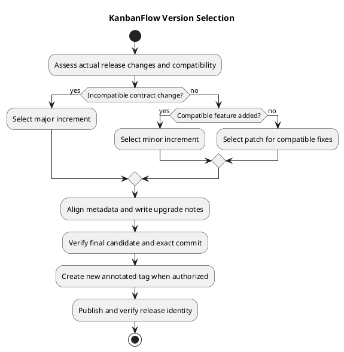

# KanbanFlow Versioning Strategy

## Purpose and policy status

This guide defines a working MAJOR.MINOR.PATCH release policy for KanbanFlow and the evidence needed to apply it. Version selection reflects actual compatibility and behavior, not merely a commit prefix or the number of changed files.

This documentation update does not increment the application version, create a tag, or publish a release. Actual version changes and publication require the agreed release scope.

## Version meaning

| Increment | Use when | Example direction |
| --- | --- | --- |
| Major | An intentionally incompatible supported contract changes. | Removing an API/behavior consumers depend on without a compatible transition. |
| Minor | Compatible user-facing functionality is added. | New optional theme or workflow capability preserving existing contracts. |
| Patch | Compatible defects are corrected. | Restoring intended validation, session configuration, or cache refresh behavior. |

Reset lower components when incrementing a higher one: 1.1.0 to 2.0.0 for a major, 1.1.0 to 1.2.0 for a minor, or 1.1.0 to 1.1.1 for a patch. These are illustrative values, not approved future releases.

For mixed changes, choose the increment required by the most significant compatibility effect. A database migration alone does not automatically determine major/minor/patch; assess the supported contract and upgrade implications.

## Compatibility assessment

Review:

- API routes, request/response shapes, validation, and supported consumers.
- User-visible behavior and documented permission rules.
- Data schema, stored-record compatibility, and migration requirements.
- Configuration, runtime, dependency, and build requirements.
- Deployment and rollback effects, including older security behavior.

A security fix may remove access that should never have been allowed. Explain the changed behavior and affected users even if it is treated as a patch. Do not assume every authorization change is compatible without reviewing the intended contract.

## Historical examples

| Published version | Recorded scope | Interpretation |
| --- | --- | --- |
| [v1.0.0](../Releases/v1.0.0.md) | Initial portfolio release. | Established published baseline. |
| [v1.0.1](../Releases/v1.0.1.md) | Privacy, authorization, ordering, and interaction corrections. | Recorded patch with documented access effects. |
| [v1.0.2](../Releases/v1.0.2.md) | Session configuration, analytics refresh, and naming. | Recorded patch. |
| [v1.1.0](../Releases/v1.1.0.md) | Themes and broader interface capabilities. | Recorded minor feature release. |

These classifications describe historical records, not a retrospective proof of a formally declared public API. The older v0.1.0 tag does not provide a complete historical policy by itself.

## Main, package version, and published release

Main can advance after a release without changing the last published version. Documentation and compatible styling fixes can remain ordinary commits until selected for a release.

The frontend package version identifies application metadata; a commit does not automatically publish that version. A local tag, remote tag, and GitHub release notes are separate states. Verify each when publishing.

Use [unreleased changes](../Releases/unreleased.md) as a maintained snapshot, not a live feed. Do not label every later commit a patch release.

## Metadata consistency

| Artifact | Required consistency for a release |
| --- | --- |
| [Frontend package](../../frontend/package.json) | Application version matches the intended release. |
| [Frontend lockfile](../../frontend/package-lock.json) | Relevant root/package metadata matches without unrelated dependency churn. |
| [README](../../README.md) | Current version and upgrade instructions are accurate. |
| [Changelog](../../CHANGELOG.md) | Changes, date, checks, compatibility, and known issues are explicit. |
| Release records and notes | Same version, exact source identity, upgrade effects, and limitations. |
| Annotated tag | Uses the intended v-prefixed version and resolves to the verified commit. |

Version preparation should not introduce dependency upgrades accidentally. Backend dependency versions are dependency requirements, not automatically the KanbanFlow application release number.

## Preparation sequence

1. Compare candidate changes with the previous published tag.
2. Assess compatibility and agree the release scope/version.
3. Update metadata and user-facing notes.
4. Review and verify the final integrated candidate.
5. Confirm the unused version and exact local/remote identities.
6. Create and push an annotated tag when authorized.
7. Publish notes and verify release status and source alignment.

If source or metadata changes after verification, assess and rerun affected checks before tagging the final commit. Follow the [release pipeline](release-pipeline.md) and [checklist](../Releases/release-checklist.md).

## Tag integrity and corrections

Do not silently move, reuse, or replace an existing published version tag. Main may advance, but the tag remains the source identity of that release.

For a released code defect, prepare a new verified version. For a notes/documentation error, make an explicit correction without pretending the original source changed. If a publication command fails, inspect the remote state before retrying or recreating records.

## Upgrade and rollback communication

State migrations, configuration updates, dependency/runtime changes, frontend rebuild/restart needs, and affected permissions. Say that none apply only after checking the actual release.

A code checkout does not undo database changes or restore data. Assess compatibility and security before choosing an older version. See [upgrade and rollback guidance](../Releases/upgrade-and-rollback.md).

## Prerelease and build labels

No current prerelease cadence or build-label policy is established here. If candidate labels such as alpha, beta, or rc are needed, agree their meaning, metadata handling, publication status, and promotion process before use.

Examples or candidate labels must not be presented as stable release commitments. A draft GitHub release is not a published stable release.

## Evidence and review boundaries

Record exact commit, environment, check results, and known gaps with the [verification template](../Releases/verification-template.md). CI success alone does not establish browser usability, MySQL contention, deployment, or recovery.

Keep the known manager membership loophole visible until policy and enforcement are resolved. A version bump cannot substitute for a fix or verification.

## Maintenance

Review this policy when compatibility expectations, consumers, metadata locations, release tooling, or lifecycle practices change. Preserve historical release identity, keep proposals separate from delivered releases, and synchronize the PlantUML source and preview.

## PlantUML diagram

[Editable source](diagrams/versioning-strategy.puml)

