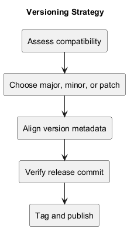
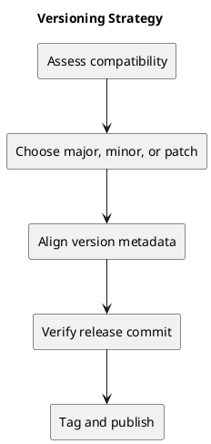

# Versioning Strategy

## Proposed version policy

Use MAJOR.MINOR.PATCH: major for incompatible changes, minor for compatible features, and patch for compatible fixes. For this application, assess changed behavior, API compatibility, configuration, and database upgrade effects rather than relying on commit type alone.

v1.1.0 is the recorded theme/UI feature release. Subsequent commits do not automatically become a patch release.

## Release consistency

Keep the frontend package version, lockfile metadata, README version, changelog, release notes, and tag aligned when preparing a release. Record migrations, configuration changes, and recovery implications.

## Tag integrity

Use annotated tags for releases. Do not reuse or silently retarget an existing released version. Documentation-only changes can remain ordinary commits until included in an authorized release.

## Related evidence

- [Project definition](../Project-Definition/README.md)
- [Release history](../../CHANGELOG.md)
- [CI configuration](../../.github/workflows/ci.yml)

## PlantUML diagram

[Editable source](diagrams/versioning-strategy.puml)

