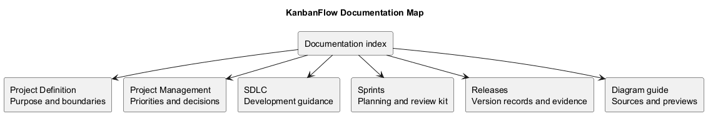
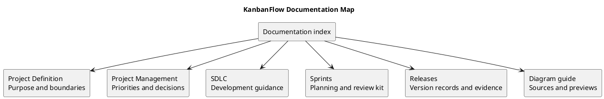

# KanbanFlow Documentation

> **Policy amendment (2026-10-10):** Membership mutations are now owner-only; DEC-003/PB-001's bypass is fixed. Earlier open-policy text and diagrams below describe the preceding state. See [QA corrections](SDLC/06-testing/qa-corrections-2026-10-10.md) for the selected rule and regression evidence.

Start here to find KanbanFlow's product definition, delivery guidance, planning records, and release evidence. For installation and the local demo, use the [project README](../README.md). For the recorded change history, use the [changelog](../CHANGELOG.md).

## Find the right document

| Your task | Start with |
| --- | --- |
| Understand the problem, goals, and product boundaries | [Project Definition](Project-Definition/README.md) |
| Choose work and resolve priorities or policy questions | [Project Management](Project-Management/README.md) |
| Follow development, testing, and maintenance guidance | [SDLC](SDLC/README.md) |
| Plan and review an agreed sprint | [Sprints](Sprints/README.md) |
| Prepare or inspect a version and its verification | [Releases](Releases/README.md) |
| Create or update a diagram and its preview | [Diagram guide](diagram-guide.md) |

New contributors should read the project setup instructions, product scope, current backlog, and relevant development phase before changing behavior. Reviewers should start with the acceptance criteria and decision record for the change, then inspect its verification evidence.

## Project Definition

These documents explain the product's purpose and boundaries. Assumptions and proposed goals must be checked against implementation and evidence before being treated as established behavior.

- [Overview and goals](Project-Definition/overview-and-goals.md)
- [Problem statement](Project-Definition/project-problem-statement.md)
- [Assumptions and constraints](Project-Definition/assumptions-and-constraints.md)
- [Scope and stakeholders](Project-Definition/scope-and-stakeholders.md)
- [Stakeholders and external systems](Project-Definition/stakeholders-and-external-systems.md)
- [Risks and success criteria](Project-Definition/risks-and-success-criteria.md)
- [Project context diagram](Project-Definition/project-context-diagram.md)
- [Scope boundary diagram](Project-Definition/scope-boundary-diagram.md)

## Project Management

Use these guides to connect needs, decisions, work items, checks, and delivery records. Roadmap stages and backlog entries describe planned work; they do not establish release dates or completed implementation.

- [Product backlog](Project-Management/product-backlog.md)
- [Backlog refinement](Project-Management/backlog-refinement.md)
- [Roadmap](Project-Management/roadmap.md)
- [Decision register](Project-Management/decision-register.md)
- [Quality and risk plan](Project-Management/quality-and-risk-plan.md)
- [Sprint workflow](Project-Management/sprint-workflow.md)
- [Traceability](Project-Management/traceability.md)
- [Documentation traceability](Project-Management/documentation-traceability.md)
- [Release pipeline](Project-Management/release-pipeline.md)
- [Versioning strategy](Project-Management/versioning-strategy.md)
- [Milestones index](Project-Management/milestones.md)

Historical milestone records live in their own folder:

| Record | Subject |
| --- | --- |
| [Milestone 5](Project-Management/Milestones/MILESTONE_5.md) | Comments and activity |
| [Milestone 6](Project-Management/Milestones/MILESTONE_6.md) | Assignment notifications |
| [Milestone 7](Project-Management/Milestones/MILESTONE_7.md) | Analytics and assignee controls |
| [Milestone 8](Project-Management/Milestones/MILESTONE_8.md) | CI and frontend code splitting |

Historical test totals and milestone results belong to their recorded revision. Recheck affected behavior for a new candidate rather than carrying old results forward.

## Software Development Lifecycle

The [SDLC index](SDLC/README.md) explains how the phases connect. They provide an iterative process, not a declaration that every phase or production deployment has been completed.

| Phase | Guide |
| --- | --- |
| 01 | [Planning](SDLC/01-planning/README.md) |
| 02 | [Requirements](SDLC/02-requirements/README.md) |
| 03 | [Analysis](SDLC/03-analysis/README.md) |
| 04 | [Design](SDLC/04-design/README.md) |
| 05 | [Implementation](SDLC/05-implementation/README.md) |
| 06 | [Testing](SDLC/06-testing/README.md) |
| 07 | [Deployment](SDLC/07-deployment/README.md) |
| 08 | [Maintenance](SDLC/08-maintenance/README.md) |

## Sprints

The sprint section contains working guides and templates. Create dated sprint records only when goals, dates, and participants are agreed; repository commits alone do not establish a sprint history or velocity.

- [Sprint planning](Sprints/sprint-planning.md)
- [Sprint backlog template](Sprints/sprint-backlog.md)
- [Sprint record template](Sprints/sprint-record-template.md)
- [Daily progress and blockers](Sprints/daily-progress.md)
- [Definition of Ready](Sprints/definition-of-ready.md)
- [Definition of Done](Sprints/definition-of-done.md)
- [Sprint review](Sprints/sprint-review.md)
- [Sprint retrospective](Sprints/sprint-retrospective.md)
- [Sprint metrics and evidence](Sprints/sprint-metrics.md)

## Releases

Use the [release index](Releases/README.md) for publication guidance and the distinctions between a commit, tag, GitHub release, and deployment. Documentation updates on `main` may be newer than a published application release.

- [Release checklist](Releases/release-checklist.md)
- [Release notes template](Releases/release-notes-template.md)
- [Verification record template](Releases/verification-template.md)
- [Upgrade and rollback](Releases/upgrade-and-rollback.md)
- [Unreleased inventory](Releases/unreleased.md) — read its stated snapshot boundary; it is not an automatically updated feed.

Recorded versions:

| Version | Release record |
| --- | --- |
| 1.0.0 | [Initial release](Releases/v1.0.0.md) |
| 1.0.1 | [Security and usability fixes](Releases/v1.0.1.md) |
| 1.0.2 | [Login configuration and analytics corrections](Releases/v1.0.2.md) |
| 1.1.0 | [UI improvements and light/dark themes](Releases/v1.1.0.md) |

## Evidence and open issues

[Local review fixes](LOCAL_REVIEW_FIXES.md) records earlier review findings and fixes. Consult the [product backlog](Project-Management/product-backlog.md), [decision register](Project-Management/decision-register.md), and [quality and risk plan](Project-Management/quality-and-risk-plan.md) for remaining work and unresolved decisions. In particular, the manager membership remove/re-add role loophole remains an open policy and implementation issue in those records.

Treat planned checks, completed checks, and unavailable checks separately. Verification records should identify the exact commit, environment, result, and evidence. A guide, diagram, passing historical test count, or published GitHub release does not establish production deployment, restore readiness, or completion of every user journey.

## Maintain the documentation

1. Update the document that owns the subject and link related guidance rather than copying conflicting rules.
2. Keep behavior descriptions aligned with code and record proposed or historical behavior explicitly.
3. Update this index when adding, moving, or removing a document; repair incoming relative links.
4. Follow the [diagram guide](diagram-guide.md): keep PlantUML sources, embedded blocks, and rendered previews consistent.
5. Check links, inspect changed diagrams, and review the diff before committing the related files together.
6. For release evidence, record real outcomes and exact revisions; leave unknown values pending.

Application setup belongs in the root README, released changes in the changelog and version records, and working process guidance in the relevant category. Keep passwords, tokens, and personal account details out of all documentation.

## Documentation map

[PlantUML source](diagrams/README.puml)

