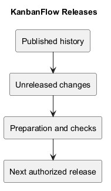
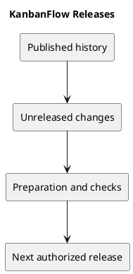

# KanbanFlow Releases

This folder records published releases and provides working guidance for preparing future releases. [CHANGELOG.md](../../CHANGELOG.md) remains the main change history. A GitHub release records source delivery; it does not establish a production deployment.

## Published releases

| Version | Published UTC date | Focus |
| --- | --- | --- |
| [v1.1.0](v1.1.0.md) | 2026-10-07 | Themes and UI/UX. |
| [v1.0.2](v1.0.2.md) | 2026-10-06 | Login configuration, analytics, and branding. |
| [v1.0.1](v1.0.1.md) | 2026-10-06 | Privacy, authorization, and Kanban interactions. |
| [v1.0.0](v1.0.0.md) | 2026-07-25 | Initial portfolio release. |

The older v0.1.0 tag exists but has no published release in the retrieved GitHub release list. No release claims are inferred from that tag.

## Release operations

- [Unreleased changes](unreleased.md)
- [Release checklist](release-checklist.md)
- [Verification record template](verification-template.md)
- [Upgrade and rollback guidance](upgrade-and-rollback.md)
- [Release notes template](release-notes-template.md)
- [Version policy](../Project-Management/versioning-strategy.md)

Each document includes PlantUML and a GitHub-visible PNG preview. Editable sources are in diagrams/. Regenerate the previews whenever the sources change.

## Evidence boundaries

Historical validation is attributed to published notes. New verification must identify its exact commit and environment. Do not describe proposed work, local edits, or untagged main commits as a published patch.

## PlantUML diagram

[Editable source](diagrams/README.puml)

